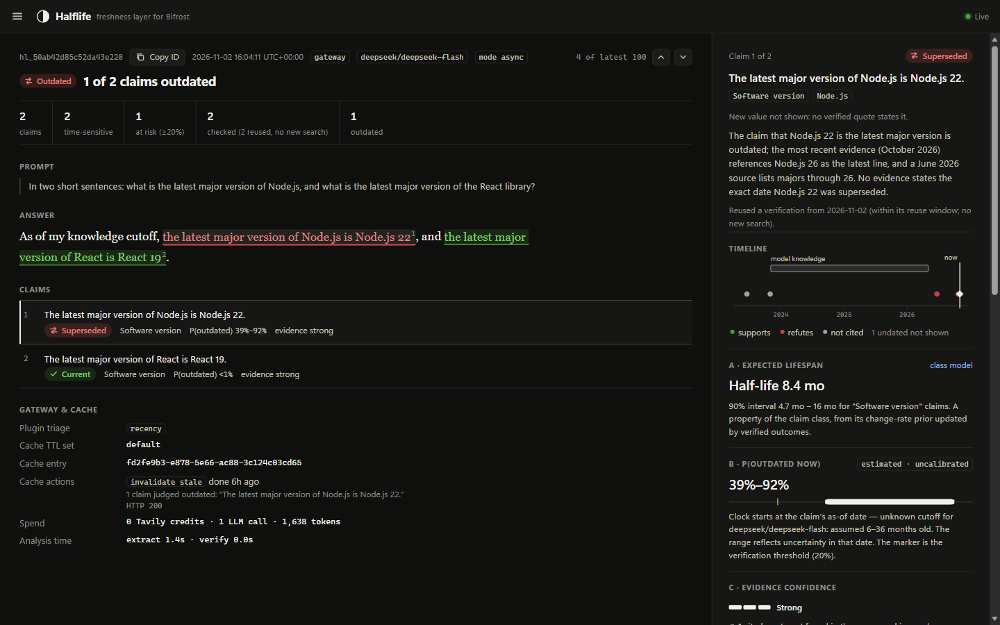
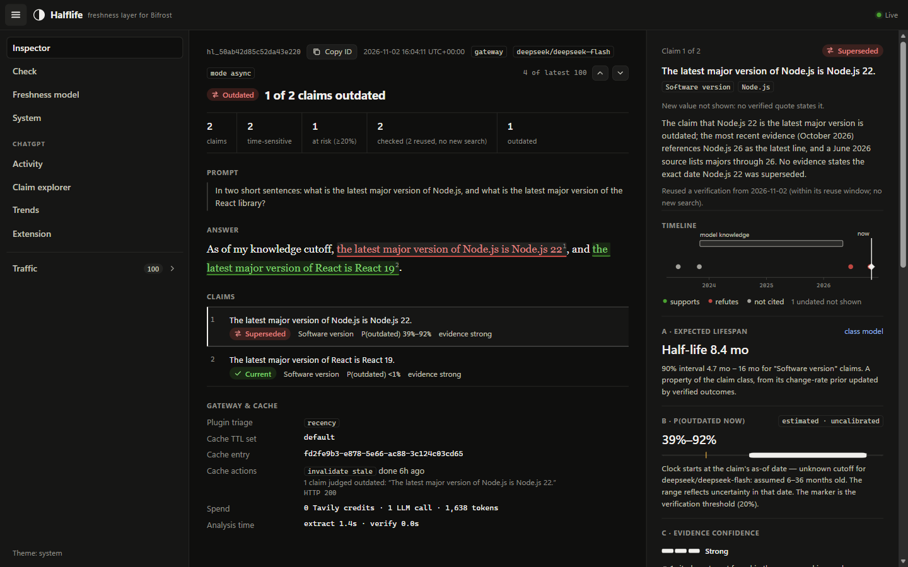
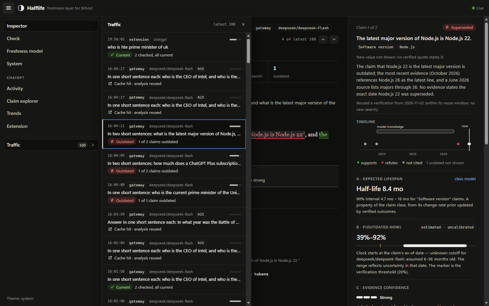
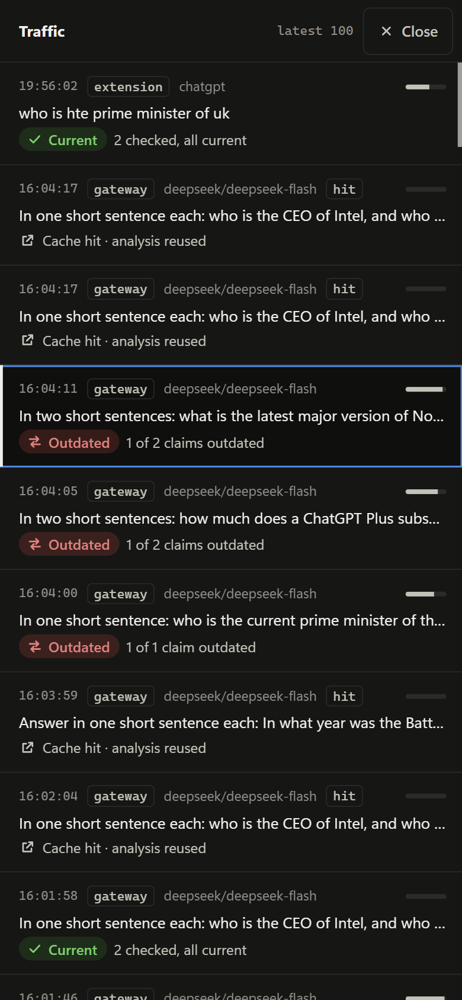
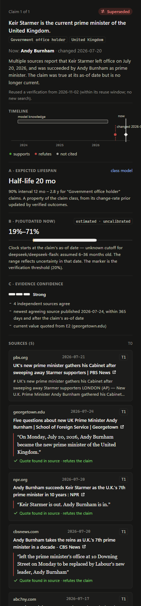
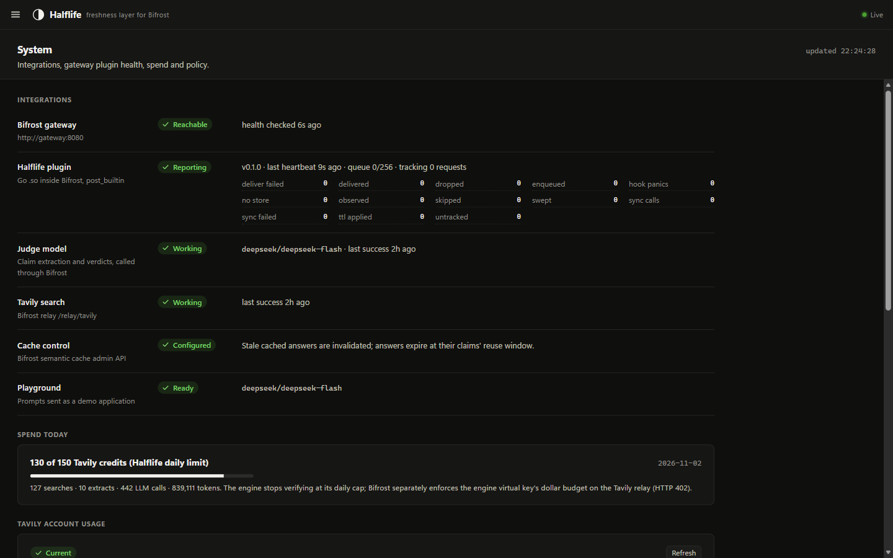
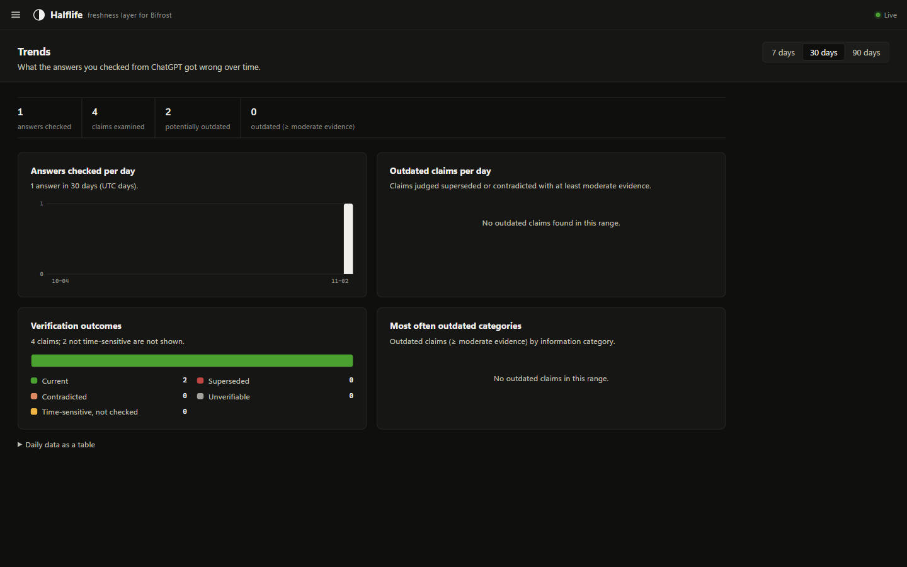
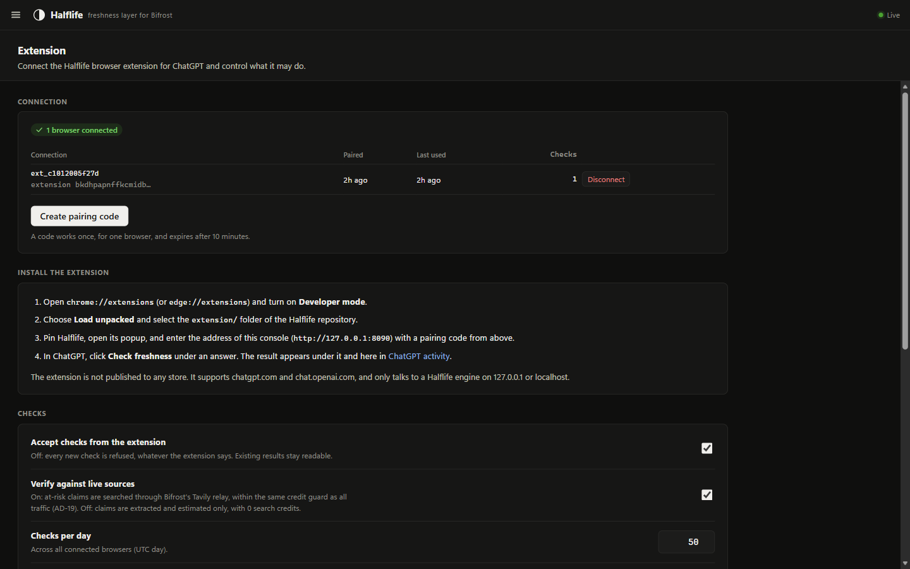
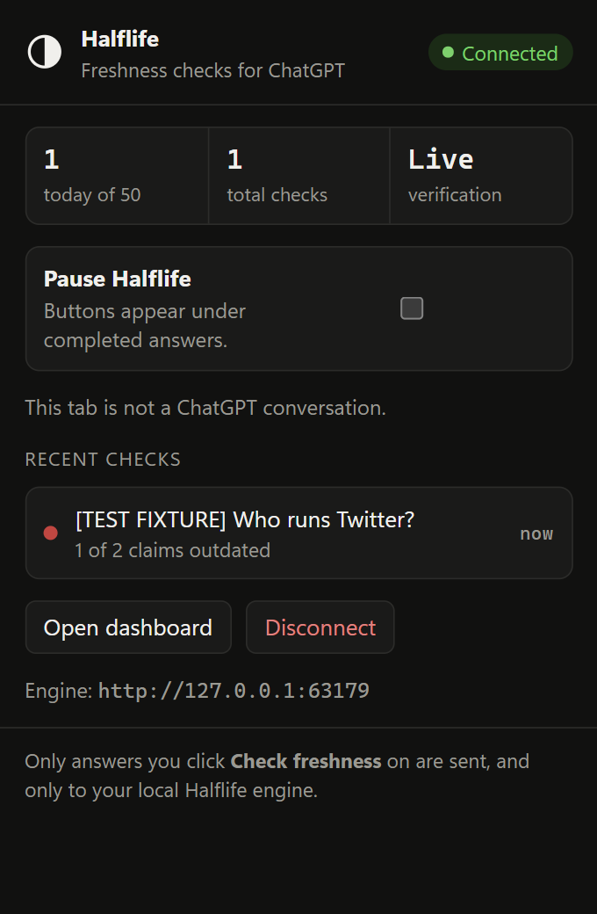

# Halflife

**Every factual claim has a different expiration rate. Halflife tells your AI stack when to check again.**

Halflife is a **freshness-risk detection and verification layer** for LLM traffic, built as an extension to the [Bifrost](https://github.com/maximhq/bifrost) AI gateway. It finds the claims in a model's answer that are likely to have gone out of date, checks the risky ones against live web evidence from [Tavily](https://tavily.com), reports a claim-level verdict with verified quotes, and adjusts the gateway's response cache accordingly.

Halflife is **not a general fact-checker**. It answers one question: *has this claim gone stale?* Claims that cannot go out of date ("The Battle of Hastings was in 1066") are never checked, even if they are wrong.

> **Status:** hackathon prototype (Geek Room Global AI Hackathon 2026, Bifrost Problem 04 and Tavily Problem 06). It runs end to end against real services and has a test suite, but it is **not production-ready**: single node, SQLite storage, not load-tested, and the outdated-probability score is **not calibrated**. See [Implementation status](#implementation-status) and [Known limitations](#known-limitations).



<sub>A real report from a local development run (DeepSeek answer, Tavily evidence), shown with the sidebar collapsed. Times are in UTC. More in [Console](#console).</sub>

---

## Contents

- [The problem](#the-problem)
- [How Halflife works](#how-halflife-works)
- [Key features](#key-features)
- [Architecture](#architecture)
- [Technology stack](#technology-stack)
- [Quick start](#quick-start)
- [Configuration](#configuration)
- [Usage](#usage)
- [Console](#console)
- [Freshness model](#freshness-model)
- [ChatGPT extension](#chatgpt-extension)
- [Tests](#tests)
- [Implementation status](#implementation-status)
- [Demo](#demo)
- [Cost controls](#cost-controls)
- [Security and privacy](#security-and-privacy)
- [Evaluation](#evaluation)
- [Known limitations](#known-limitations)
- [Project structure](#project-structure)
- [Contributing](#contributing)
- [License](#license)
- [Acknowledgements](#acknowledgements)

Detailed documentation:
[Architecture](docs/ARCHITECTURE.md) ·
[Installation](docs/INSTALLATION.md) ·
[Development](docs/DEVELOPMENT.md) ·
[Security](docs/SECURITY.md) ·
[Evaluation](docs/EVALUATION.md) ·
[Contributing](CONTRIBUTING.md) ·
[Changelog](CHANGELOG.md)

---

## The problem

An LLM answer mixes facts with very different shelf lives. "The chemical symbol for gold is Au" never expires. "The latest major version of Node.js is 22" expires within months. "Keir Starmer is the UK prime minister" was true when many current models were trained and stopped being true in July 2026. Models state all three with the same confidence, from training data that is months or years old.

**Why decay rates differ:** how quickly a claim goes stale depends on what kind of fact it is. Prices and market figures change in days or weeks; software versions in months; office holders and company leadership in a year or two; historical facts and definitions not at all. A claim's risk of being outdated is therefore a function of its *class* and its *age* (the time since the date it describes, or the model's training cutoff when no date is stated). Halflife models each of 18 claim classes with its own change rate, so a "latest version" claim from an old model is treated as risky while "the Battle of Hastings was in 1066" is never searched.

A gateway cache makes this worse: it can keep serving yesterday's answer for hours without knowing which parts of it are volatile. Checking every answer against the web is slow and costly; checking none ships outdated facts to users.

**Why freshness detection matters:** most of the cost of keeping answers current can be avoided by *not* checking claims that cannot change, and by reusing a recent verification instead of searching again. Halflife spends search credits only where the expected staleness risk is high, and gives the gateway a reason to shorten or drop cache entries for volatile answers.

## How Halflife works

For every chat completion that passes through the gateway:

1. **Inline triage (Go plugin inside Bifrost, tens of microseconds).** Lexical cues ("latest", "current", prices, versions, office titles…) cap the cache TTL for volatile answers or mark price answers `no-store`. The answer is handed to the engine asynchronously, or synchronously in `verify` mode. Every hook fails open.
2. **Claim extraction and classification (engine).** An LLM, called through Bifrost, splits the answer into atomic claims and assigns each to one of 18 classes (office holder, software version, price…). Every claim span must occur verbatim in the answer. Without an LLM key, a labelled rule-based extractor is used instead.
3. **Freshness-risk estimate.** For each class, a Gamma–Poisson change-rate model gives the probability that the claim has changed since its as-of date (stated in the text, or the model's knowledge cutoff as a range).
4. **Verification of risky claims only.** Claims above a risk threshold (default 20%, at most 3 per answer) are searched with Tavily through a Bifrost relay. An LLM judge returns a verdict with quotes; **every quote is checked against the fetched source in code**, and a verdict without verifiable quotes is discarded.
5. **Report and cache action.** The claim-level report is stored and exposed via API and console. A claim confirmed outdated (with at least moderate evidence) invalidates the cached answer in Bifrost; otherwise the entry is set to expire when its claims' reuse window ends.

### Three separate measures

Halflife never blends these into one score:

| Measure | What it describes | Form |
|---|---|---|
| **Freshness risk** — *P(outdated now)* | how likely *this claim* has changed since its as-of date, from its class's change rate | a probability range, labelled **estimated · uncalibrated** |
| **Verification verdict** | what current evidence says about the claim | `current` / `superseded` / `contradicted` / `unverifiable` (or `not_checked` with a reason) |
| **Evidence confidence** | how strong the evidence behind the verdict is | ordinal: `strong` / `moderate` / `weak` / `none`, from explicit rules — **never a percentage** |

A class-level *expected lifespan* (half-life with a 90% interval) is also shown; it is a property of the class, not of the claim.

**The language model never produces a number.** It returns spans, a class from a closed list, dates, a verdict enum and quotes, all validated in code.

## Key features

- Bifrost extension using only supported extension points: a Go `.so` plugin (six hooks), two Relays, the semantic-cache TTL context key and the cache admin API. No Bifrost source changes.
- Claim-level verdicts with quotes verified against the source text; replacement values shown only when a verified quote states them.
- Cache policy driven by freshness: TTL caps, `no-store` for prices, invalidation of confirmed-stale entries, expiry at the reuse window, cache hits linked to the original analysis at no cost.
- `verify` mode: the reply waits for verification and carries a freshness note when a claim is outdated, and is never cached.
- Spend bounded in layers: per answer, per day, lifetime, a Tavily account guard (a share of the allowance Tavily's usage API reports for your account), and the Bifrost virtual-key dollar budget.
- Honest degradation: without a Tavily key, risky claims are reported as "not checked"; without an LLM key, extraction is rule-based and labelled; no verdict is ever invented.
- Operator console: a collapsible navigation sidebar; a live **Traffic** panel (the latest 100 reports) that opens beside the sidebar, or as a full-screen sheet on phones; claim spans highlighted in the answer, sources and verified quotes, the class model, Tavily account usage as Tavily reports it, and Halflife's own spending limits.
- Opt-in ChatGPT browser extension that sends one selected answer to your local engine for the same analysis.
- Engine has **zero npm dependencies** (Node 24 native TypeScript stripping, `node:sqlite`, `node:test`).

## Architecture

```
Client ──► Bifrost v2.4.0 (OpenAI-compatible) ─────────────────────────► LLM provider (DeepSeek)
            │ semantic_cache (exact match)
            │ halflife plugin (.so, post_builtin)   triage · TTL / no-store · capture · hand-off · headers
            ├─ /relay/tavily/*    ──► Tavily  (key held by Bifrost; priced per credit; VK budget → 402)
            └─ /relay/halflife/*  ──► Halflife engine API (virtual-key gated, route allow-list)

Halflife engine (Node 24, zero dependencies)
  extract + classify (LLM via Bifrost) → freshness model → triage → Tavily ladder (reuse · search · extract)
  → schema-checked verdict, quotes verified in code → evidence level → learning → cache actions
  SQLite store · REST API · SSE · operator console (http://localhost:8090)
```

Two deployables: the **plugin** does only microsecond-scale inline work, so heavy or failing code can never take down the gateway; the **engine** does everything else. Full detail: [docs/ARCHITECTURE.md](docs/ARCHITECTURE.md). Every design decision with its rationale: [research/ARCHITECTURE_DECISIONS.md](research/ARCHITECTURE_DECISIONS.md).

### How Bifrost is integrated

- **Plugin:** `plugin/` is compiled as a Go plugin *inside* Bifrost's `transports/v2.4.0` module (pinned commit `e869c3f`, checked at build time) so dependency versions match the host exactly. It uses `HTTPTransportPreHook`, `PreLLMHook`, `PostLLMHook`, `HTTPTransportPostHook`, `HTTPTransportStreamChunkHook` and `HTTPTransportResponseHeadersHook`, and depends only on `core/schemas` and the Go standard library.
- **Relays:** `/relay/tavily/*` holds the Tavily key and prices each call per Tavily credit against the engine's virtual key; `/relay/halflife/*` exposes the engine API behind a virtual key with a route allow-list.
- **Cache:** Bifrost's `semantic_cache` plugin in exact-match mode; Halflife sets its TTL context key and calls its admin API to invalidate entries.
- **LLM traffic:** all LLM calls, including Halflife's own, go through Bifrost. The engine's calls carry a secret internal token so the plugin skips them (no loops).
- The gateway image is built from source (the official image is statically linked and cannot load Go plugins).

This project does **not** claim any upstream acceptance or contribution to Bifrost.

### How Tavily is integrated

- **T0:** reuse a stored verification of the same normalised claim inside its reuse window — 0 credits.
- **T1:** Tavily `search` (basic depth, published dates, topic chosen by claim class, 5 results) — 1 credit.
- **T2:** Tavily `extract` on the top two URLs, only if no quote from T1 could be verified — about 1 credit.
- The engine never holds the Tavily key; every call goes through the Bifrost relay. A free `GET /usage` route lets the engine read the account counter before paid calls.

### How DeepSeek is used

The reference deployment uses **DeepSeek through Bifrost's native `deepseek` provider**, with `deepseek/deepseek-flash` as the judge for both extraction/classification and verdicts, **thinking disabled** and temperature 0. Structured output is requested as JSON schema; Bifrost rewrites it to DeepSeek's `json_object` mode. Override with `HALFLIFE_LLM_MODEL` (e.g. `deepseek/deepseek-v4-pro`). Other Bifrost providers (OpenAI, Anthropic, Gemini, Groq, OpenRouter, Mistral, Ollama) are wired into the config renderer but **only DeepSeek has been verified against the live service** in this project.

## Technology stack

| Layer | Technology |
|---|---|
| Gateway | Bifrost `transports/v2.4.0`, built from source in `golang:1.27.3-bookworm` |
| Plugin | Go (CGO, `-buildmode=plugin`), standard library + `bifrost/core/schemas` |
| Engine | Node.js 24 (native type stripping of `.ts`), `node:sqlite`, `node:http`, `node:test`; no npm dependencies |
| Console | Vanilla ES modules, HTML, CSS; no framework or build step |
| Search | Tavily Search and Extract APIs (via Bifrost relay) |
| LLM | DeepSeek (`deepseek-flash`) via Bifrost |
| Deployment | Docker Compose v2 |

## Quick start

**Prerequisites:** Docker with Compose v2 (Docker Desktop on Windows/macOS), Node.js 24+, Git, and about 5 GB of free disk for the first build. For live operation: a Tavily API key and a DeepSeek API key (with a positive balance). Without keys the stack still runs in a reduced, clearly labelled mode.

```bash
git clone https://github.com/fazeprism25/halflife.git && cd halflife
node deploy/setup.mjs                  # creates deploy/.env with generated local secrets (prints names only)
# edit deploy/.env: set TAVILY_API_KEY and DEEPSEEK_API_KEY (see deploy/.env.example)
docker compose -f deploy/docker-compose.yml up --build
```

The first build clones and compiles Bifrost and takes several minutes. When both containers report `healthy` (`docker ps`):

| What | Where |
|---|---|
| Gateway (OpenAI-compatible) | `http://localhost:8080/v1/chat/completions` |
| Halflife console | `http://localhost:8090` |
| Halflife API through Bifrost | `http://localhost:8080/relay/halflife/v1/...` (header `x-bf-vk: <HALFLIFE_DEMO_VK>`) |

Ports bind to `127.0.0.1` only. Step-by-step instructions for Windows, Linux and macOS, troubleshooting and every environment variable: [docs/INSTALLATION.md](docs/INSTALLATION.md).

> **Key precedence:** Compose takes provider keys from your **shell environment first** and `deploy/.env` second. A key exported in your shell is used even if `deploy/.env` leaves it empty.

There are no npm dependencies, so there is no `npm install` step. To try the extension, see [ChatGPT extension](#chatgpt-extension).

## Configuration

All configuration is environment variables in `deploy/.env` (created by `setup.mjs`; documented with placeholders in [`deploy/.env.example`](deploy/.env.example); gitignored). The ones you are most likely to set:

| Variable (default) | Purpose |
|---|---|
| `TAVILY_API_KEY`, `DEEPSEEK_API_KEY` | provider keys; held by the gateway only, never by the engine |
| `HALFLIFE_LLM_MODEL` (`deepseek/deepseek-flash` with DeepSeek) | judge model for extraction and verdicts |
| `HALFLIFE_DAILY_CREDIT_CAP` (`150`), `HALFLIFE_TOTAL_CREDIT_CAP` (`700`) | Halflife's own daily and lifetime Tavily credit limits |
| `HALFLIFE_TAVILY_CEILING_FRACTION` (`0.8`, max `0.95`) | share of the allowance Tavily's `/usage` reports that the account guard allows |
| `HALFLIFE_ENGINE_BUDGET_USD` (`2`), `HALFLIFE_DEMO_BUDGET_USD` (`1`) | Bifrost daily dollar budgets on the engine and demo virtual keys |
| `HALFLIFE_CONSOLE_TOKEN` (empty) | require a token for the console API |

The generated secrets (ingest, internal and relay tokens, admin token, virtual keys) need no editing. After changing `deploy/.env`, recreate the containers (`docker compose -f deploy/docker-compose.yml up -d --force-recreate`). Full reference: [docs/INSTALLATION.md §6](docs/INSTALLATION.md#6-configuration-reference).

## Usage

The examples use `$HALFLIFE_DEMO_VK`, the virtual key generated into `deploy/.env` by `setup.mjs`. Load it into your shell without printing it, for example in bash: `export HALFLIFE_DEMO_VK=$(grep '^HALFLIFE_DEMO_VK=' deploy/.env | cut -d= -f2-)`.

### Send traffic through the gateway

```bash
curl -i http://localhost:8080/v1/chat/completions \
  -H "content-type: application/json" -H "x-bf-vk: $HALFLIFE_DEMO_VK" \
  -d '{"model":"deepseek/deepseek-flash","thinking":{"type":"disabled"},"messages":[{"role":"user","content":"In one short sentence: what is the latest major version of Node.js?"}]}'
```

Response headers added by the plugin:

| Header | Meaning |
|---|---|
| `x-halflife-report` | report ID (open it in the console or via `/v1/reports/{id}`) |
| `x-halflife-mode` | `async`, `verify` or `off` |
| `x-halflife-triage` | lexical cue groups that matched, or `none` |
| `x-halflife-ttl` | cache TTL applied, `default` or `no-store` |
| `x-halflife-cache` | `hit` when served from Bifrost's cache |
| `x-halflife-status` | verification summary (in `verify` mode) |

Request header `x-halflife-mode: verify` waits for verification before replying; `x-halflife-mode: off` opts a request out.

> DeepSeek enables "thinking" by default. Send `"thinking":{"type":"disabled"}` in application requests with small `max_tokens`, or the reply can be empty (Halflife reports it as `skipped; no-text`).

### Check text directly

```bash
curl http://localhost:8080/relay/halflife/v1/check -H "x-bf-vk: $HALFLIFE_DEMO_VK" \
  -H "content-type: application/json" \
  -d '{"text":"As of 2023, Jack Dorsey is the CEO of Twitter.","question":"Who is the CEO of Twitter?","wait":true}'
```

`/v1/check` body fields: `text` (required), `question`, `model` (the model that wrote the text; used for its knowledge cutoff), `as_of` (`YYYY-MM`), `wait` (return the finished report), `verify: false` (assess risk only — no search, no credits), `learn: false` (do not update the class model; use for evaluation traffic).

### API endpoints

Through the relay (`/relay/halflife` prefix, header `x-bf-vk`):

| Method | Path | Purpose |
|---|---|---|
| `GET` | `/v1/health` | liveness |
| `GET` | `/v1/status` | integrations, plugin heartbeat, spend and guard status, policy |
| `GET` | `/v1/classes` | the 18 claim classes with priors and learned posteriors |
| `GET` | `/v1/reports?limit=&before=` | recent reports |
| `GET` | `/v1/reports/{id}` | one claim-level report |
| `POST` | `/v1/check` | analyse a text |

The console (port 8090) additionally uses `/v1/events` (server-sent events) and `/v1/playground`. The plugin uses `/v1/ingest` and `/v1/plugin/heartbeat` on the internal network with its own token.

### Example workflow

1. Ask the gateway "What is the latest major version of Node.js, and of React?" DeepSeek answers "Node.js 22, React 19".
2. The plugin sees the `recency` cue and hands the answer to the engine; the reply returns immediately with `x-halflife-report`.
3. The engine extracts two `software.version` claims; both are above the risk threshold.
4. Tavily evidence shows Node.js 26 is current: claim 1 → `superseded`, evidence `strong`; React 19 → `current`.
5. The engine deletes the stale entry from Bifrost's cache; the next identical request is a cache miss.
6. The console shows the answer with both claims highlighted, the quotes, dates, the three measures and the spend (2 Tavily credits).

## Console

The engine serves an operator console at <http://localhost:8090> (vanilla HTML, CSS and ES modules; no build step). It updates live over server-sent events.

**Layout.** A slim top bar holds the menu button, the brand and the live indicator. The navigation is a **collapsible sidebar**, collapsed by default so the report uses the full width:
- **≥ 1100 px:** the sidebar docks beside the page; the open/closed choice is remembered in the browser.
- **< 1100 px:** it opens as a modal overlay that closes with ✕, Escape, a click outside, a navigation link or choosing a report.

**Traffic** (the latest 100 reports, live) is one item in the sidebar. Clicking it, or pressing `T` anywhere, opens a panel **to the right of the sidebar**; the sidebar and its navigation never move. The panel is 360–440 px wide depending on the space available (needs 700 px of viewport). **Below 700 px it is a full-screen sheet** with a labelled Close button. The header stays fixed and only the list scrolls. It closes with Traffic again, ✕/Close, Escape, a click outside, a navigation link or choosing a report; arrow keys, Home and End move through the list. It always starts closed.

**Pages:** Inspector (one report: the answer with claims highlighted in place, a claim panel with timeline, the three measures, evidence rules and quote-verified sources, gateway and cache actions, spend), Check (send a prompt through the gateway or check text directly), Freshness model (the 18 classes with priors and learned posteriors), System (integrations, plugin counters, Tavily account usage, Halflife spending limits, policy), and the ChatGPT section (Activity, Claim explorer, Trends, Extension).

All screenshots below were captured from the running local stack at commit `a2a296e` in a real (headed) Edge window, with the browser's time zone set to UTC. Unless marked TEST FIXTURE, the data are real reports from live DeepSeek and Tavily calls made during development and a real chatgpt.com check made with the extension; nothing was edited. Index: [`docs/assets/screenshots/`](docs/assets/screenshots/README.md).

| | |
|---|---|
|  **Expanded sidebar** (desktop, docked) |  **Traffic** opens sideways, to the right of the sidebar |
|  **Tablet** (1024 px): overlay sidebar with Traffic beside it |  **Phone** (390 px): Traffic as a full-screen sheet |
|  **Claim panel** (verify mode): superseded, current value, evidence rules and quotes checked against each source |  **Freshness model:** half-life per class with 90% intervals, prior vs posterior |
|  **System:** integrations and plugin health |  **System:** Tavily account usage as `/usage` reports it, and Halflife's separate limits |

## Freshness model

Halflife keeps three measures apart and never blends them into one score (details in [How Halflife works](#three-separate-measures) and [docs/ARCHITECTURE.md](docs/ARCHITECTURE.md#freshness-model-ad-09)):

- **Class change rate.** Each of the 18 classes has a Gamma prior on its rate of change λ (a Poisson process), with a written rationale in `engine/src/classes.ts`. It is shown as a half-life with a 90% interval. Two classes (historical facts, definitions/constants) do not expire and are never checked.
- **P(outdated now).** For a claim of age Δt since its as-of date, `1 − (β/(β+Δt))^α` (the Gamma–Poisson marginal), evaluated on a λ grid. The as-of date is an interval (a stated date, an earlier verification, the model's cited cutoff, or an assumed 6–36 months for unknown cutoffs), so the result is a range. Claims at or above θ = 20% are verified, at most 3 per answer.
- **Reuse window.** After a verification, the claim is not searched again until P(outdated since verification) reaches θ.
- **Learning.** Verdicts with strong or moderate evidence update the class posterior. Evaluation and extension traffic send `learn: false`.

**Limitations of the model:** the priors are hand-set; P(outdated) is **not calibrated** (labelled *estimated · uncalibrated* in the console); few verified outcomes have updated it; and an unknown model cutoff makes the range wide. The verdict that decides cache actions comes from evidence, not from this number.

## ChatGPT extension

An opt-in Manifest V3 browser extension ([`extension/`](extension/README.md)) adds **Check freshness** under completed ChatGPT answers (chatgpt.com, chat.openai.com).
- **One answer at a time:** clicking sends only that answer and the user message before it to **your local engine**. The engine runs the same pipeline as gateway traffic: extraction, freshness model, Bifrost-routed judge, Tavily relay and credit guard.
- **In ChatGPT:** a compact result appears under the answer.
- **In the console:** a **ChatGPT** section holds:
  - **Activity:** checked answers, linked to the Inspector
  - **Claim explorer:** verdicts, expected lifespan, quote-verified sources
  - **Trends:** real per-day aggregates
  - **Extension:** pairing, opt-in settings, privacy statement, deletion

The extension holds no provider key. It pairs with the console through a one-time code and gets a revocable token bound to its origin, which can only create and read its own checks. Nothing is sent until you click. Install steps, data flow and the security model are in [extension/README.md](extension/README.md); the design is AD-32 in [research/ARCHITECTURE_DECISIONS.md](research/ARCHITECTURE_DECISIONS.md).

**Install (developer mode, not in any store):** open `chrome://extensions` or `edge://extensions`, turn on Developer mode, **Load unpacked** → the `extension/` folder. In the console open ChatGPT → Extension → **Create pairing code**, then enter the console address and the code in the extension's popup.

The extension was tested by the maintainer on real chatgpt.com (answers recognised, checks reached the local engine, results shown in the console). The first four screenshots below show real data from that test; the last two were taken with the real extension on a **TEST FIXTURE** page that carries ChatGPT's message markup, against Halflife's scripted test engine, because the live page would show a personal account.

| | |
|---|---|
|  **Activity:** a real chatgpt.com answer, four claims, two checked live |  **Claim explorer:** each claim with lifespan, P(outdated) and quote-verified sources |
|  **Trends:** real per-day aggregates (only one real check so far, so the charts are sparse) |  **Extension settings:** paired browsers, pairing codes, limits |
|  **TEST FIXTURE:** the compact result under a checked answer, and the **Check freshness** button |  **TEST FIXTURE:** the extension popup (connection, pause, recent checks) |

## Tests

```bash
cd engine && npm test && cd ..                 # 76 engine unit and HTTP tests (no Docker, no keys)
node engine/scripts/check-imports.mjs          # every engine module imports cleanly
node --test engine/test/console-ui.test.mjs    # 15 console UI checks in headless Edge/Chrome (test fixtures)
node --test "extension/test/*.test.mjs"        # 8 adapter + 6 end-to-end browser-extension tests (Edge/Chrome)
node deploy/test/integration.mjs               # 13 end-to-end checks against the real Bifrost binary (Docker, port 8080)
docker build -f deploy/gateway.Dockerfile --target plugin-test --no-cache-filter plugin-test --progress=plain .
                                               # 21 Go plugin tests with -race, plus benchmarks
```

| Suite | Last result | When |
|---|---|---|
| Engine | **76/76** | re-run on the final code, 2026-11-03 |
| Console UI | **15/15** | re-run on the final code, 2026-11-03 |
| Extension (adapter + e2e) | **14/14** | re-run on the final code, 2026-11-03; the first of three runs failed 9/14 on a pairing timeout, see [Known limitations](#known-limitations) |
| Integration | **13/13** | re-run on the final code with a rebuilt engine image, 2026-11-03 |
| Go plugin (`-race`) | **21/21** | last run 2026-11-02 (session 5); the plugin has not changed since |

The integration suite builds and starts the real gateway, plugin and engine, with scripted **test fixtures** (`deploy/test/fixtures.mjs`) standing in for the LLM provider and Tavily, so it needs **no credentials and spends nothing**. It uses port 8080, so stop a running stack first (`NO_BUILD=1` reuses already-built images). The console UI and extension suites need Edge or Chrome; the extension end-to-end test also needs `openssl` (Git for Windows ships one). Live tests against real services (which spend credits, bounded by a guard) are described in [docs/DEVELOPMENT.md](docs/DEVELOPMENT.md).

There is no hosted CI for this repository.

## Implementation status

| Area | Status |
|---|---|
| Bifrost plugin (six hooks, triage, TTL / `no-store`, hand-off, `verify` mode, fail-open) | implemented and tested |
| Claim extraction and classification (LLM with validation; labelled rule-based fallback) | implemented and tested |
| Freshness model (18 classes, Gamma–Poisson, reuse windows, learning) | implemented; **uncalibrated** |
| Tavily verification (reuse, search, extract; quotes verified in code) | implemented; live-verified with real Tavily |
| Cache actions (TTL caps, `no-store`, invalidation, expiry, linked cache hits) | implemented; integration-tested on real Bifrost |
| Spend controls (per answer, daily, lifetime, Tavily account guard, Bifrost VK budget) | implemented and tested |
| Console (sidebar, Traffic panel, Inspector, Check, model, System, ChatGPT pages) | implemented; UI-tested in Edge/Chrome |
| ChatGPT extension | implemented; automated tests on fixtures; one manual pass on real chatgpt.com |
| FreshQA-based evaluation | done for detection and verification; calibration not measured |
| Demo runner and script | done; **demo video not recorded** |
| Upstream Bifrost contribution | **not done** (no PR or proposal) |
| Production hardening (multi-node, load testing, auth beyond a console token, CI) | **not done** |

## Demo

With the stack running and keys configured:

```bash
node deploy/demo/run-demo.mjs
```

This runs the steps of [research/DEMO_SCRIPT.md](research/DEMO_SCRIPT.md) through the real stack (time-invariant claims cost nothing; verify-before-reply; claim-level verdicts on a mixed answer; cache invalidation; cache-hit reuse) and writes a transcript to `deploy/demo/results/`. It spends a few Tavily credits (fewer when recent verifications are reused) and checks the spend guard before starting.

## Cost controls

- **Per answer:** at most 3 claims verified (riskiest first), only above the risk threshold θ = 0.2. Time-invariant claims are never searched.
- **Reuse:** a verified claim is reused, at 0 credits, until its reuse window ends.
- **Engine caps:** daily (`HALFLIFE_DAILY_CREDIT_CAP`, default 150) and lifetime (`HALFLIFE_TOTAL_CREDIT_CAP`, default 700) Tavily credits.
- **Tavily account guard:** the engine reads your account's usage and allowance from Tavily's `GET /usage` through the relay (free; cached 5 minutes, within Tavily's 10-reads-per-10-minutes limit). Before every paid call it refuses beyond `HALFLIFE_TAVILY_CEILING_FRACTION` (default 0.8, clamped to 0.95 in code) of the allowance Tavily reports, on any pay-as-you-go usage, or when usage or a finite allowance cannot be read. No allowance is assumed or hardcoded. Credits Tavily's dashboard shows but the API does not report (such as add-on credits) are not counted. Tavily's counter was observed to lag by hours, so the guard also counts every credit it reserves locally. The daily and lifetime caps above are independent of the provider allowance. System → "Tavily account usage" shows the provider's figures, and "Halflife spending limits" shows the engine's own.
- **Bifrost budget:** a daily dollar budget on the engine's virtual key (`HALFLIFE_ENGINE_BUDGET_USD`, default $2); Bifrost returns 402 when exhausted.
- **Scripts:** every live script calls `preflight()` / `reconcile()` in `deploy/test/spend-guard.mjs`, which refuses to start a run whose worst case would cross the ceiling and records actual spend in a local ledger.

A claim refused by any limit is reported as `not_checked` (reason `budget`): never given a verdict, never retried.

## Security and privacy

- Provider and Tavily keys live only in the gateway's environment; the rendered Bifrost config contains `env.NAME` references, never values. The engine never sees them.
- Engine callers are authenticated separately: plugin (ingest token), relay (bearer token injected by Bifrost), console (header, optionally a token via `HALFLIFE_CONSOLE_TOKEN`).
- Answers and web evidence are treated as untrusted data: delimited in prompts, outputs schema-validated, spans and quotes checked against their sources.
- **Data stored locally:** the engine stores prompts, answers, claims and evidence excerpts in SQLite (14-day retention by default); Bifrost's own log store also records requests. Virtual keys are stored only as short SHA-256 fingerprints. Text sent through Halflife is sent to the configured LLM provider and claim text to Tavily.
- **ChatGPT extension:** opt-in per answer, with no background capture and no telemetry. It sends only to a loopback engine with a paired, origin-bound token, and its checks never feed the learning model. See [extension/README.md](extension/README.md).
- Ports bind to localhost. The console has **no authentication unless `HALFLIFE_CONSOLE_TOKEN` is set** — do not expose port 8090.

Details and threat boundaries: [docs/SECURITY.md](docs/SECURITY.md).

## Evaluation

Measured on 2026-11-02 with real DeepSeek and Tavily calls, on items drawn from two public snapshots of [FreshQA](https://github.com/freshllms/freshqa) (2024-02-26 and 2026-04-21). Every item is FreshQA's question and answer verbatim; no statements were hand-written.

| Question | Result |
|---|---|
| **Detection:** is the claim time-sensitive? (100 items, assess-only, 0 credits) | precision **85.5%**, recall **97.9%**, F1 0.91; 7 answers yielded no claim |
| **Verification:** 29 known-stale (2024) answers + 30 answers current at the 2026-04-21 snapshot, counting verdicts with ≥ moderate evidence | stale precision **95.8%** (92.0% if the one unadjudicated item is wrong); recall 95.8% of decided, 79.3% of all stale items; coverage 83% / 70% |
| Changes after the snapshot that Halflife flagged | 8, each confirmed by independent web search |
| Replacement values on stale claims (26) | 10 match the dataset, 7 confirmed later changes, **2 wrong**, 1 unadjudicated, 6 omitted |
| Cost | 1.04 Tavily credits per searched claim; ~4.5k DeepSeek tokens per checked claim; p50 3.9 s, p95 7.9 s |

**Caveats:** the sets are small (100 + 59 items); a single judge model (`deepseek-flash`) was used; adjudication of disputed items was done by the AI assistant that built the system, with sources recorded in `eval/freshqa-adjudications.json`, not by independent humans; the outdated-probability score was **not** evaluated for calibration and is **uncalibrated**. FreshQA data is not redistributed here (no stated data licence); the scripts to rebuild and rerun the evaluation are included. Methodology, failure analysis and how to reproduce: [docs/EVALUATION.md](docs/EVALUATION.md).

## Known limitations

- **Scope:** freshness only. Time-invariant claims are never checked, so wrong static facts pass through.
- **P(outdated) is uncalibrated.** It is a prior from hand-set class change rates updated by a small number of verified outcomes. The verdict comes from evidence, not from this number.
- **Replacement values are weaker than verdicts** (2 of 26 wrong in FreshQA); grounding cannot tell "up to Node.js 26" from "the latest is Node.js 26".
- **The judge can make date or count reasoning errors.** Future-dated changes are discarded in code; count errors are not guarded.
- **Tavily `published_date`** can be wrong for evergreen/SEO pages.
- **DeepSeek's knowledge cutoff is unpublished**, so the assumed as-of range for its answers is wide (6–36 months).
- **Streams:** the TTL is decided from the prompt only; verification of streamed answers is asynchronous only.
- **Learning:** repeated prompts with slightly different wording can add near-duplicate observations.
- **Operational:** single engine node with SQLite; not load-tested; Bifrost's UI is replaced by a stub page; governance usage counters reset on gateway restart; it is unverified whether the Bifrost dollar budget meters DeepSeek spend.
- Only the DeepSeek provider and the test fixtures have been exercised end to end; other providers are configured but untested.
- **Tavily add-on credits are invisible to Halflife.** The account guard uses the allowance Tavily's `/usage` API reports (`account.plan_limit`). Credits that only Tavily's dashboard shows, such as add-on credits, are not counted and not spent, so the guard can stop earlier than the dashboard total suggests. This is deliberate; Halflife never raises its own limits.
- **ChatGPT extension:** it reads ChatGPT's page structure, which can change without notice; Chromium only (Edge, Chrome); text answers only; not in any store; it needs the engine running on the same machine. The real-site test was one manual pass, not itemised.
- **Test coverage of the UI:** console and extension tests run in Edge/Chrome only (no Firefox or Safari). The extension end-to-end suite failed once (9/14, a pairing timeout that cascaded) before passing 14/14 twice on unchanged code; the cause was not identified.
- **Console caching:** console files are served `no-cache` with an ETag, so a browser always revalidates. A browser that cached the console from a version older than `a2a296e` (when CSS/JS had a 5-minute cache) may need one hard reload.

## Project structure

| Path | Contents |
|---|---|
| `plugin/` | Go plugin for Bifrost v2.4.0: hooks, triage, per-request state, delivery, tests |
| `engine/src/` | engine: freshness model, extraction, verification, evidence rules, store, API |
| `engine/test/` | engine tests (`node:test`) and test fakes |
| `engine/console/` | operator console (vanilla ES modules), including the ChatGPT pages |
| `extension/` | Manifest V3 browser extension for ChatGPT: platform adapter, content script, service worker, popup, tests |
| `shared/temporal-cues.json` | lexical cues shared by the plugin and the engine |
| `deploy/` | Dockerfiles, Compose file, config renderer, setup script, `.env.example` |
| `deploy/test/` | integration suite, test fixtures, live scripts, spend guard |
| `deploy/demo/` | demo runner |
| `eval/` | hand-labelled sets, FreshQA builder/runner/scorer, adjudication notes, v1/v2 result summaries |
| `docs/assets/screenshots/` | console and extension screenshots, with an index of what each shows and where its data came from |
| `experiments/feasibility/` | feasibility-sprint probe plugin, configs and measured results (historical) |
| `research/` | research report, feasibility report, architecture decisions, implementation log, project state, demo script, submission draft |
| `docs/` | developer documentation |

## Contributing

See [CONTRIBUTING.md](CONTRIBUTING.md). In short: run the engine tests (and the plugin and integration suites when you touch those parts), never commit `deploy/.env` or anything under `engine/data/`, keep the engine dependency-free, and record design decisions in `research/ARCHITECTURE_DECISIONS.md`.

## License

Halflife is licensed under the **[Apache License 2.0](LICENSE)**. Copyright 2026 The Halflife authors; see [NOTICE](NOTICE).

Third-party components keep their own licences. Bifrost (Apache-2.0) and its Go dependencies are downloaded and compiled at build time and are not included in this repository, but images you build contain them. The FreshQA dataset is cited, not redistributed, because its data carries no stated licence. Details and attribution: [THIRD_PARTY_NOTICES.md](THIRD_PARTY_NOTICES.md).

## Acknowledgements

- [Bifrost](https://github.com/maximhq/bifrost) (`maximhq`; Apache-2.0, Copyright 2025 H3 Labs Inc.), the gateway Halflife extends.
- [Tavily](https://tavily.com) for search and extraction, and [DeepSeek](https://www.deepseek.com) for the reference judge model.
- [FreshQA](https://github.com/freshllms/freshqa) (Vu et al., 2023, arXiv:2310.03214), used for the evaluation.
- Built for the Geek Room Global AI Hackathon 2026, with an AI coding assistant (Claude Code); see the AI-use disclosure in [research/SUBMISSION.md](research/SUBMISSION.md).
