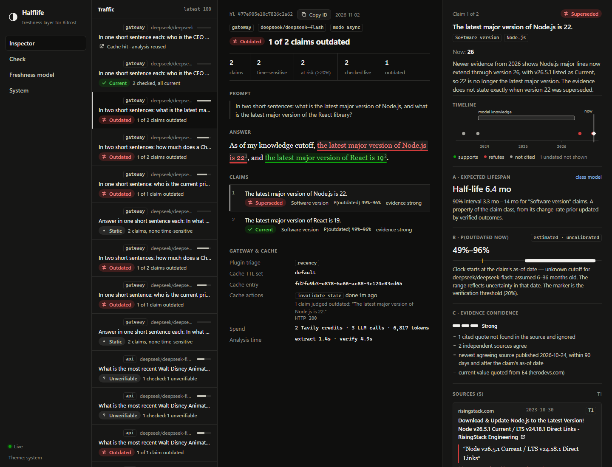

# Halflife

**Every factual claim has a different expiration rate. Halflife tells your AI stack when to check again.**

Halflife is a **freshness-risk detection and verification layer** for LLM traffic, built as an extension to the [Bifrost](https://github.com/maximhq/bifrost) AI gateway. It finds the claims in a model's answer that are likely to have gone out of date, checks the risky ones against live web evidence from [Tavily](https://tavily.com), reports a claim-level verdict with verified quotes, and adjusts the gateway's response cache accordingly.

Halflife is **not a general fact-checker**. It answers one question: *has this claim gone stale?* Claims that cannot go out of date ("The Battle of Hastings was in 1066") are never checked, even if they are wrong.

> **Status:** hackathon prototype (Geek Room Global AI Hackathon 2026, Bifrost Problem 04 and Tavily Problem 06). It runs end to end against real services and has a test suite, but it is **not production-ready**: single node, SQLite storage, not load-tested, and the outdated-probability score is **not calibrated**. See [Known limitations](#known-limitations).

---

## Contents

- [The problem](#the-problem)
- [How Halflife works](#how-halflife-works)
- [Key features](#key-features)
- [Architecture](#architecture)
- [Technology stack](#technology-stack)
- [Quick start](#quick-start)
- [Usage](#usage)
- [Tests](#tests)
- [Demo](#demo)
- [Cost controls](#cost-controls)
- [Security and privacy](#security-and-privacy)
- [Evaluation](#evaluation)
- [Known limitations](#known-limitations)
- [Project structure](#project-structure)
- [Contributing](#contributing)
- [License](#license)
- [Acknowledgements](#acknowledgements)

Detailed documentation:
[Architecture](docs/ARCHITECTURE.md) ·
[Installation](docs/INSTALLATION.md) ·
[Development](docs/DEVELOPMENT.md) ·
[Security](docs/SECURITY.md) ·
[Evaluation](docs/EVALUATION.md) ·
[Contributing](CONTRIBUTING.md) ·
[Changelog](CHANGELOG.md)

---

## The problem

An LLM answer mixes facts with very different shelf lives. "The chemical symbol for gold is Au" never expires. "The latest major version of Node.js is 22" expires within months. "Keir Starmer is the UK prime minister" was true when many current models were trained and stopped being true in July 2026. Models state all three with the same confidence, from training data that is months or years old.

A gateway cache makes this worse: it can keep serving yesterday's answer for hours without knowing which parts of it are volatile. Checking every answer against the web is slow and costly; checking none ships outdated facts to users.

**Why freshness detection matters:** most of the cost of keeping answers current can be avoided by *not* checking claims that cannot change, and by reusing a recent verification instead of searching again. Halflife spends search credits only where the expected staleness risk is high, and gives the gateway a reason to shorten or drop cache entries for volatile answers.

## How Halflife works

For every chat completion that passes through the gateway:

1. **Inline triage (Go plugin inside Bifrost, tens of microseconds).** Lexical cues ("latest", "current", prices, versions, office titles…) cap the cache TTL for volatile answers or mark price answers `no-store`. The answer is handed to the engine asynchronously, or synchronously in `verify` mode. Every hook fails open.
2. **Claim extraction and classification (engine).** An LLM, called through Bifrost, splits the answer into atomic claims and assigns each to one of 18 classes (office holder, software version, price…). Every claim span must occur verbatim in the answer. Without an LLM key, a labelled rule-based extractor is used instead.
3. **Freshness-risk estimate.** For each class, a Gamma–Poisson change-rate model gives the probability that the claim has changed since its as-of date (stated in the text, or the model's knowledge cutoff as a range).
4. **Verification of risky claims only.** Claims above a risk threshold (default 20%, at most 3 per answer) are searched with Tavily through a Bifrost relay. An LLM judge returns a verdict with quotes; **every quote is checked against the fetched source in code**, and a verdict without verifiable quotes is discarded.
5. **Report and cache action.** The claim-level report is stored and exposed via API and console. A claim confirmed outdated (with at least moderate evidence) invalidates the cached answer in Bifrost; otherwise the entry is set to expire when its claims' reuse window ends.

### Three separate measures

Halflife never blends these into one score:

| Measure | What it describes | Form |
|---|---|---|
| **Freshness risk** — *P(outdated now)* | how likely *this claim* has changed since its as-of date, from its class's change rate | a probability range, labelled **estimated · uncalibrated** |
| **Verification verdict** | what current evidence says about the claim | `current` / `superseded` / `contradicted` / `unverifiable` (or `not_checked` with a reason) |
| **Evidence confidence** | how strong the evidence behind the verdict is | ordinal: `strong` / `moderate` / `weak` / `none`, from explicit rules — **never a percentage** |

A class-level *expected lifespan* (half-life with a 90% interval) is also shown; it is a property of the class, not of the claim.

**The language model never produces a number.** It returns spans, a class from a closed list, dates, a verdict enum and quotes, all validated in code.

## Key features

- Bifrost extension using only supported extension points: a Go `.so` plugin (six hooks), two Relays, the semantic-cache TTL context key and the cache admin API. No Bifrost source changes.
- Claim-level verdicts with quotes verified against the source text; replacement values shown only when a verified quote states them.
- Cache policy driven by freshness: TTL caps, `no-store` for prices, invalidation of confirmed-stale entries, expiry at the reuse window, cache hits linked to the original analysis at no cost.
- `verify` mode: the reply waits for verification and carries a freshness note when a claim is outdated, and is never cached.
- Spend bounded in layers: per answer, per day, lifetime, a Tavily free-allowance guard, and the Bifrost virtual-key dollar budget.
- Honest degradation: without a Tavily key, risky claims are reported as "not checked"; without an LLM key, extraction is rule-based and labelled; no verdict is ever invented.
- Operator console: live report feed, claim spans highlighted in the answer, sources and quotes, the class model, spend and guard status.
- Engine has **zero npm dependencies** (Node 24 native TypeScript stripping, `node:sqlite`, `node:test`).

## Architecture

```
Client ──► Bifrost v2.4.0 (OpenAI-compatible) ─────────────────────────► LLM provider (DeepSeek)
            │ semantic_cache (exact match)
            │ halflife plugin (.so, post_builtin)   triage · TTL / no-store · capture · hand-off · headers
            ├─ /relay/tavily/*    ──► Tavily  (key held by Bifrost; priced per credit; VK budget → 402)
            └─ /relay/halflife/*  ──► Halflife engine API (virtual-key gated, route allow-list)

Halflife engine (Node 24, zero dependencies)
  extract + classify (LLM via Bifrost) → freshness model → triage → Tavily ladder (reuse · search · extract)
  → schema-checked verdict, quotes verified in code → evidence level → learning → cache actions
  SQLite store · REST API · SSE · operator console (http://localhost:8090)
```

Two deployables: the **plugin** does only microsecond-scale inline work, so heavy or failing code can never take down the gateway; the **engine** does everything else. Full detail: [docs/ARCHITECTURE.md](docs/ARCHITECTURE.md). Every design decision with its rationale: [research/ARCHITECTURE_DECISIONS.md](research/ARCHITECTURE_DECISIONS.md).

### How Bifrost is integrated

- **Plugin:** `plugin/` is compiled as a Go plugin *inside* Bifrost's `transports/v2.4.0` module (pinned commit `e869c3f`, checked at build time) so dependency versions match the host exactly. It uses `HTTPTransportPreHook`, `PreLLMHook`, `PostLLMHook`, `HTTPTransportPostHook`, `HTTPTransportStreamChunkHook` and `HTTPTransportResponseHeadersHook`, and depends only on `core/schemas` and the Go standard library.
- **Relays:** `/relay/tavily/*` holds the Tavily key and prices each call per Tavily credit against the engine's virtual key; `/relay/halflife/*` exposes the engine API behind a virtual key with a route allow-list.
- **Cache:** Bifrost's `semantic_cache` plugin in exact-match mode; Halflife sets its TTL context key and calls its admin API to invalidate entries.
- **LLM traffic:** all LLM calls, including Halflife's own, go through Bifrost. The engine's calls carry a secret internal token so the plugin skips them (no loops).
- The gateway image is built from source (the official image is statically linked and cannot load Go plugins).

This project does **not** claim any upstream acceptance or contribution to Bifrost.

### How Tavily is integrated

- **T0:** reuse a stored verification of the same normalised claim inside its reuse window — 0 credits.
- **T1:** Tavily `search` (basic depth, published dates, topic chosen by claim class, 5 results) — 1 credit.
- **T2:** Tavily `extract` on the top two URLs, only if no quote from T1 could be verified — about 1 credit.
- The engine never holds the Tavily key; every call goes through the Bifrost relay. A free `GET /usage` route lets the engine read the account counter before paid calls.

### How DeepSeek is used

The reference deployment uses **DeepSeek through Bifrost's native `deepseek` provider**, with `deepseek/deepseek-flash` as the judge for both extraction/classification and verdicts, **thinking disabled** and temperature 0. Structured output is requested as JSON schema; Bifrost rewrites it to DeepSeek's `json_object` mode. Override with `HALFLIFE_LLM_MODEL` (e.g. `deepseek/deepseek-v4-pro`). Other Bifrost providers (OpenAI, Anthropic, Gemini, Groq, OpenRouter, Mistral, Ollama) are wired into the config renderer but **only DeepSeek has been verified against the live service** in this project.

## Technology stack

| Layer | Technology |
|---|---|
| Gateway | Bifrost `transports/v2.4.0`, built from source in `golang:1.27.3-bookworm` |
| Plugin | Go (CGO, `-buildmode=plugin`), standard library + `bifrost/core/schemas` |
| Engine | Node.js 24 (native type stripping of `.ts`), `node:sqlite`, `node:http`, `node:test`; no npm dependencies |
| Console | Vanilla ES modules, HTML, CSS; no framework or build step |
| Search | Tavily Search and Extract APIs (via Bifrost relay) |
| LLM | DeepSeek (`deepseek-flash`) via Bifrost |
| Deployment | Docker Compose v2 |

## Quick start

**Prerequisites:** Docker with Compose v2 (Docker Desktop on Windows/macOS), Node.js 24+, Git, and about 5 GB of free disk for the first build. For live operation: a Tavily API key and a DeepSeek API key (with a positive balance). Without keys the stack still runs in a reduced, clearly labelled mode.

```bash
git clone <this repository> halflife && cd halflife
node deploy/setup.mjs                  # creates deploy/.env with generated local secrets (prints names only)
# edit deploy/.env: set TAVILY_API_KEY and DEEPSEEK_API_KEY (see deploy/.env.example)
docker compose -f deploy/docker-compose.yml up --build
```

The first build clones and compiles Bifrost and takes several minutes. When both containers report `healthy` (`docker ps`):

| What | Where |
|---|---|
| Gateway (OpenAI-compatible) | `http://localhost:8080/v1/chat/completions` |
| Halflife console | `http://localhost:8090` |
| Halflife API through Bifrost | `http://localhost:8080/relay/halflife/v1/...` (header `x-bf-vk: <HALFLIFE_DEMO_VK>`) |

Ports bind to `127.0.0.1` only. Step-by-step instructions for Windows, Linux and macOS, troubleshooting and every environment variable: [docs/INSTALLATION.md](docs/INSTALLATION.md).

> **Key precedence:** Compose takes provider keys from your **shell environment first** and `deploy/.env` second. A key exported in your shell is used even if `deploy/.env` leaves it empty.

## Usage

The examples use `$HALFLIFE_DEMO_VK`, the virtual key generated into `deploy/.env` by `setup.mjs`. Load it into your shell without printing it, for example in bash: `export HALFLIFE_DEMO_VK=$(grep '^HALFLIFE_DEMO_VK=' deploy/.env | cut -d= -f2-)`.

### Send traffic through the gateway

```bash
curl -i http://localhost:8080/v1/chat/completions \
  -H "content-type: application/json" -H "x-bf-vk: $HALFLIFE_DEMO_VK" \
  -d '{"model":"deepseek/deepseek-flash","thinking":{"type":"disabled"},"messages":[{"role":"user","content":"In one short sentence: what is the latest major version of Node.js?"}]}'
```

Response headers added by the plugin:

| Header | Meaning |
|---|---|
| `x-halflife-report` | report ID (open it in the console or via `/v1/reports/{id}`) |
| `x-halflife-mode` | `async`, `verify` or `off` |
| `x-halflife-triage` | lexical cue groups that matched, or `none` |
| `x-halflife-ttl` | cache TTL applied, `default` or `no-store` |
| `x-halflife-cache` | `hit` when served from Bifrost's cache |
| `x-halflife-status` | verification summary (in `verify` mode) |

Request header `x-halflife-mode: verify` waits for verification before replying; `x-halflife-mode: off` opts a request out.

> DeepSeek enables "thinking" by default. Send `"thinking":{"type":"disabled"}` in application requests with small `max_tokens`, or the reply can be empty (Halflife reports it as `skipped; no-text`).

### Check text directly

```bash
curl http://localhost:8080/relay/halflife/v1/check -H "x-bf-vk: $HALFLIFE_DEMO_VK" \
  -H "content-type: application/json" \
  -d '{"text":"As of 2023, Jack Dorsey is the CEO of Twitter.","question":"Who is the CEO of Twitter?","wait":true}'
```

`/v1/check` body fields: `text` (required), `question`, `model` (the model that wrote the text; used for its knowledge cutoff), `as_of` (`YYYY-MM`), `wait` (return the finished report), `verify: false` (assess risk only — no search, no credits), `learn: false` (do not update the class model; use for evaluation traffic).

### API endpoints

Through the relay (`/relay/halflife` prefix, header `x-bf-vk`):

| Method | Path | Purpose |
|---|---|---|
| `GET` | `/v1/health` | liveness |
| `GET` | `/v1/status` | integrations, plugin heartbeat, spend and guard status, policy |
| `GET` | `/v1/classes` | the 18 claim classes with priors and learned posteriors |
| `GET` | `/v1/reports?limit=&before=` | recent reports |
| `GET` | `/v1/reports/{id}` | one claim-level report |
| `POST` | `/v1/check` | analyse a text |

The console (port 8090) additionally uses `/v1/events` (server-sent events) and `/v1/playground`. The plugin uses `/v1/ingest` and `/v1/plugin/heartbeat` on the internal network with its own token.

### Example workflow

1. Ask the gateway "What is the latest major version of Node.js, and of React?" DeepSeek answers "Node.js 22, React 19".
2. The plugin sees the `recency` cue and hands the answer to the engine; the reply returns immediately with `x-halflife-report`.
3. The engine extracts two `software.version` claims; both are above the risk threshold.
4. Tavily evidence shows Node.js 26 is current: claim 1 → `superseded`, evidence `strong`; React 19 → `current`.
5. The engine deletes the stale entry from Bifrost's cache; the next identical request is a cache miss.
6. The console shows the answer with both claims highlighted, the quotes, dates, the three measures and the spend (2 Tavily credits).



More console screenshots, captured from a local run on 2026-11-02, are in [`docs/assets/screenshots/`](docs/assets/screenshots/). Local clock times and the time zone have been blanked out; nothing else was changed.

## Tests

```bash
cd engine && npm test && cd ..                                         # 54 engine unit/integration tests (no Docker, no keys)
docker build -f deploy/gateway.Dockerfile --target plugin-test --no-cache-filter plugin-test --progress=plain .
                                                                       # 21 Go plugin tests with -race, plus benchmarks
node deploy/test/integration.mjs                                       # 13 end-to-end checks against real Bifrost
```

The integration suite builds and starts the real gateway, plugin and engine, with scripted **test fixtures** (`deploy/test/fixtures.mjs`) standing in for the LLM provider and Tavily, so it needs **no credentials and spends nothing**. It uses port 8080, so stop a running stack first. Live tests against real services (which spend credits, bounded by a guard) are described in [docs/DEVELOPMENT.md](docs/DEVELOPMENT.md).

There is no hosted CI for this repository.

## Demo

With the stack running and keys configured:

```bash
node deploy/demo/run-demo.mjs
```

This runs the steps of [research/DEMO_SCRIPT.md](research/DEMO_SCRIPT.md) through the real stack (time-invariant claims cost nothing; verify-before-reply; claim-level verdicts on a mixed answer; cache invalidation; cache-hit reuse) and writes a transcript to `deploy/demo/results/`. It spends a few Tavily credits (fewer when recent verifications are reused) and checks the spend guard before starting.

## Cost controls

- **Per answer:** at most 3 claims verified (riskiest first), only above the risk threshold θ = 0.2. Time-invariant claims are never searched.
- **Reuse:** a verified claim is reused, at 0 credits, until its reuse window ends.
- **Engine caps:** daily (`HALFLIFE_DAILY_CREDIT_CAP`, default 150) and lifetime (`HALFLIFE_TOTAL_CREDIT_CAP`, default 700) Tavily credits.
- **Tavily free-allowance guard:** before every paid call the engine reads the account counter through the relay (free) and refuses beyond `HALFLIFE_TAVILY_CEILING_FRACTION` (default 0.8, clamped to 0.95 in code) of the plan allowance, on any pay-as-you-go usage, or when usage cannot be read. Tavily's counter was observed to lag by hours, so the guard also counts every credit it reserves locally.
- **Bifrost budget:** a daily dollar budget on the engine's virtual key (`HALFLIFE_ENGINE_BUDGET_USD`, default $2); Bifrost returns 402 when exhausted.
- **Scripts:** every live script calls `preflight()` / `reconcile()` in `deploy/test/spend-guard.mjs`, which refuses to start a run whose worst case would cross the ceiling and records actual spend in a local ledger.

A claim refused by any limit is reported as `not_checked` (reason `budget`): never given a verdict, never retried.

## Security and privacy

- Provider and Tavily keys live only in the gateway's environment; the rendered Bifrost config contains `env.NAME` references, never values. The engine never sees them.
- Engine callers are authenticated separately: plugin (ingest token), relay (bearer token injected by Bifrost), console (header, optionally a token via `HALFLIFE_CONSOLE_TOKEN`).
- Answers and web evidence are treated as untrusted data: delimited in prompts, outputs schema-validated, spans and quotes checked against their sources.
- **Data stored locally:** the engine stores prompts, answers, claims and evidence excerpts in SQLite (14-day retention by default); Bifrost's own log store also records requests. Virtual keys are stored only as short SHA-256 fingerprints. Text sent through Halflife is sent to the configured LLM provider and claim text to Tavily.
- Ports bind to localhost. The console has **no authentication unless `HALFLIFE_CONSOLE_TOKEN` is set** — do not expose port 8090.

Details and threat boundaries: [docs/SECURITY.md](docs/SECURITY.md).

## Evaluation

Measured on 2026-11-02 with real DeepSeek and Tavily calls, on items drawn from two public snapshots of [FreshQA](https://github.com/freshllms/freshqa) (2024-02-26 and 2026-04-21). Every item is FreshQA's question and answer verbatim; no statements were hand-written.

| Question | Result |
|---|---|
| **Detection:** is the claim time-sensitive? (100 items, assess-only, 0 credits) | precision **85.5%**, recall **97.9%**, F1 0.91; 7 answers yielded no claim |
| **Verification:** 29 known-stale (2024) answers + 30 answers current at the 2026-04-21 snapshot, counting verdicts with ≥ moderate evidence | stale precision **95.8%** (92.0% if the one unadjudicated item is wrong); recall 95.8% of decided, 79.3% of all stale items; coverage 83% / 70% |
| Changes after the snapshot that Halflife flagged | 8, each confirmed by independent web search |
| Replacement values on stale claims (26) | 10 match the dataset, 7 confirmed later changes, **2 wrong**, 1 unadjudicated, 6 omitted |
| Cost | 1.04 Tavily credits per searched claim; ~4.5k DeepSeek tokens per checked claim; p50 3.9 s, p95 7.9 s |

**Caveats:** the sets are small (100 + 59 items); a single judge model (`deepseek-flash`) was used; adjudication of disputed items was done by the AI assistant that built the system, with sources recorded in `eval/freshqa-adjudications.json`, not by independent humans; the outdated-probability score was **not** evaluated for calibration and is **uncalibrated**. FreshQA data is not redistributed here (no stated data licence); the scripts to rebuild and rerun the evaluation are included. Methodology, failure analysis and how to reproduce: [docs/EVALUATION.md](docs/EVALUATION.md).

## Known limitations

- **Scope:** freshness only. Time-invariant claims are never checked, so wrong static facts pass through.
- **P(outdated) is uncalibrated.** It is a prior from hand-set class change rates updated by a small number of verified outcomes. The verdict comes from evidence, not from this number.
- **Replacement values are weaker than verdicts** (2 of 26 wrong in FreshQA); grounding cannot tell "up to Node.js 26" from "the latest is Node.js 26".
- **The judge can make date or count reasoning errors.** Future-dated changes are discarded in code; count errors are not guarded.
- **Tavily `published_date`** can be wrong for evergreen/SEO pages.
- **DeepSeek's knowledge cutoff is unpublished**, so the assumed as-of range for its answers is wide (6–36 months).
- **Streams:** the TTL is decided from the prompt only; verification of streamed answers is asynchronous only.
- **Learning:** repeated prompts with slightly different wording can add near-duplicate observations.
- **Operational:** single engine node with SQLite; not load-tested; Bifrost's UI is replaced by a stub page; governance usage counters reset on gateway restart; it is unverified whether the Bifrost dollar budget meters DeepSeek spend.
- Only the DeepSeek provider and the test fixtures have been exercised end to end; other providers are configured but untested.

## Project structure

| Path | Contents |
|---|---|
| `plugin/` | Go plugin for Bifrost v2.4.0: hooks, triage, per-request state, delivery, tests |
| `engine/src/` | engine: freshness model, extraction, verification, evidence rules, store, API |
| `engine/test/` | engine tests (`node:test`) and test fakes |
| `engine/console/` | operator console (vanilla ES modules) |
| `shared/temporal-cues.json` | lexical cues shared by the plugin and the engine |
| `deploy/` | Dockerfiles, Compose file, config renderer, setup script, `.env.example` |
| `deploy/test/` | integration suite, test fixtures, live scripts, spend guard |
| `deploy/demo/` | demo runner |
| `eval/` | hand-labelled sets, FreshQA builder/runner/scorer, adjudication notes, v1/v2 result summaries |
| `docs/assets/screenshots/` | sanitised console screenshots |
| `experiments/feasibility/` | feasibility-sprint probe plugin, configs and measured results (historical) |
| `research/` | research report, feasibility report, architecture decisions, implementation log, project state, demo script, submission draft |
| `docs/` | developer documentation |

## Contributing

See [CONTRIBUTING.md](CONTRIBUTING.md). In short: run the engine tests (and the plugin and integration suites when you touch those parts), never commit `deploy/.env` or anything under `engine/data/`, keep the engine dependency-free, and record design decisions in `research/ARCHITECTURE_DECISIONS.md`.

## License

Halflife is licensed under the **[Apache License 2.0](LICENSE)**. Copyright 2026 The Halflife authors; see [NOTICE](NOTICE).

Third-party components keep their own licences. Bifrost (Apache-2.0) and its Go dependencies are downloaded and compiled at build time and are not included in this repository, but images you build contain them. The FreshQA dataset is cited, not redistributed, because its data carries no stated licence. Details and attribution: [THIRD_PARTY_NOTICES.md](THIRD_PARTY_NOTICES.md).

## Acknowledgements

- [Bifrost](https://github.com/maximhq/bifrost) (`maximhq`; Apache-2.0, Copyright 2025 H3 Labs Inc.), the gateway Halflife extends.
- [Tavily](https://tavily.com) for search and extraction, and [DeepSeek](https://www.deepseek.com) for the reference judge model.
- [FreshQA](https://github.com/freshllms/freshqa) (Vu et al., 2023, arXiv:2310.03214), used for the evaluation.
- Built for the Geek Room Global AI Hackathon 2026, with an AI coding assistant (Claude Code); see the AI-use disclosure in [research/SUBMISSION.md](research/SUBMISSION.md).
