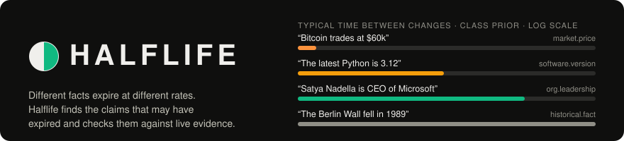
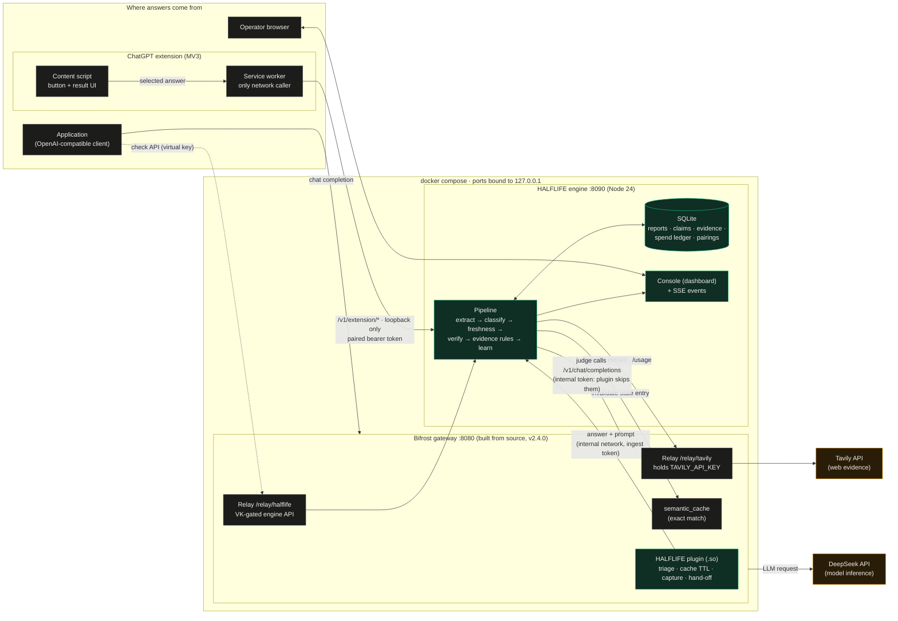
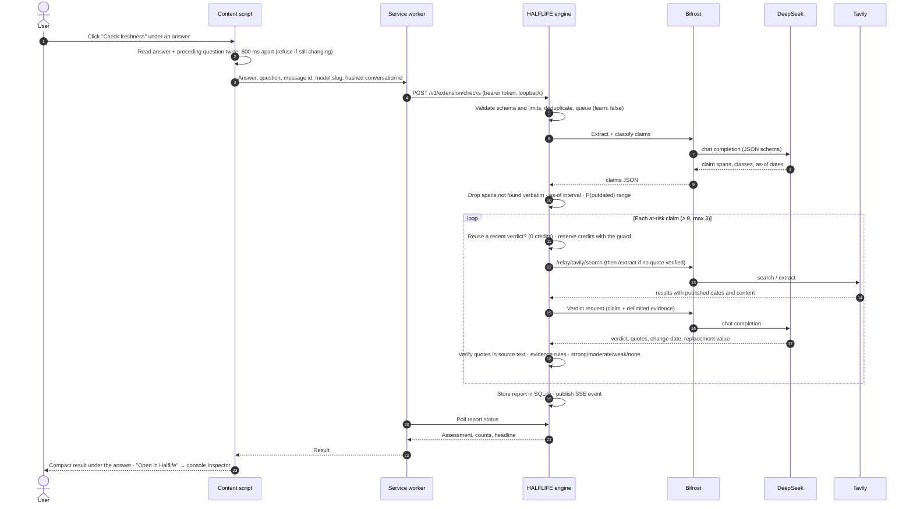
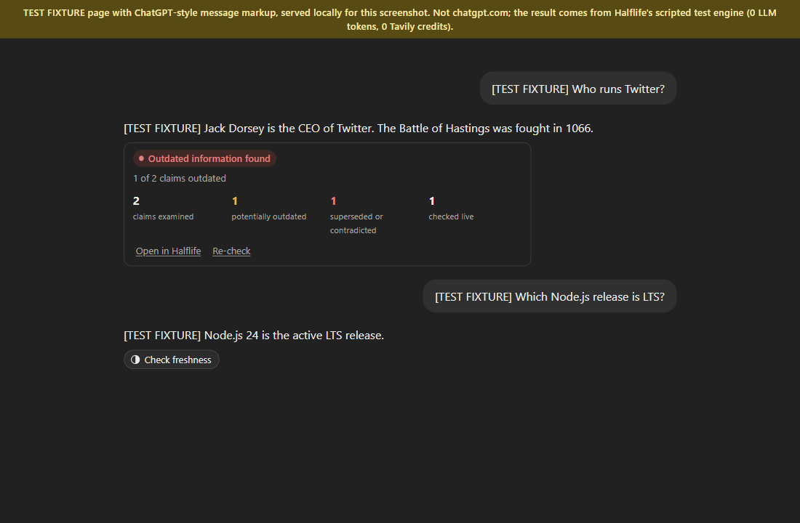
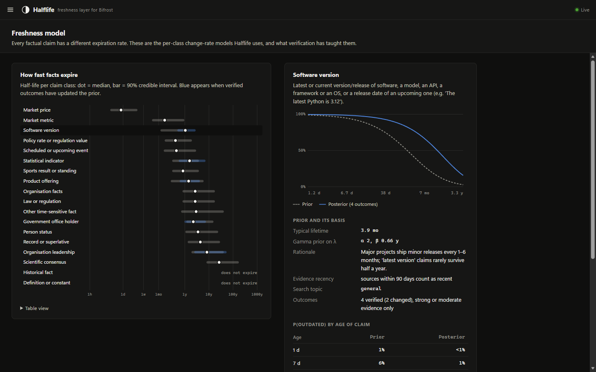
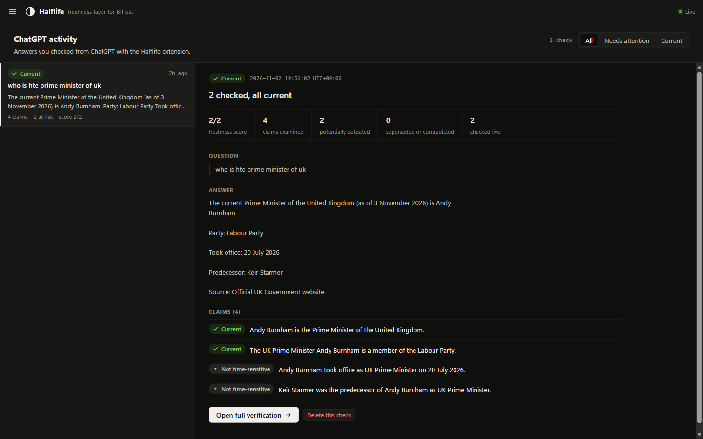
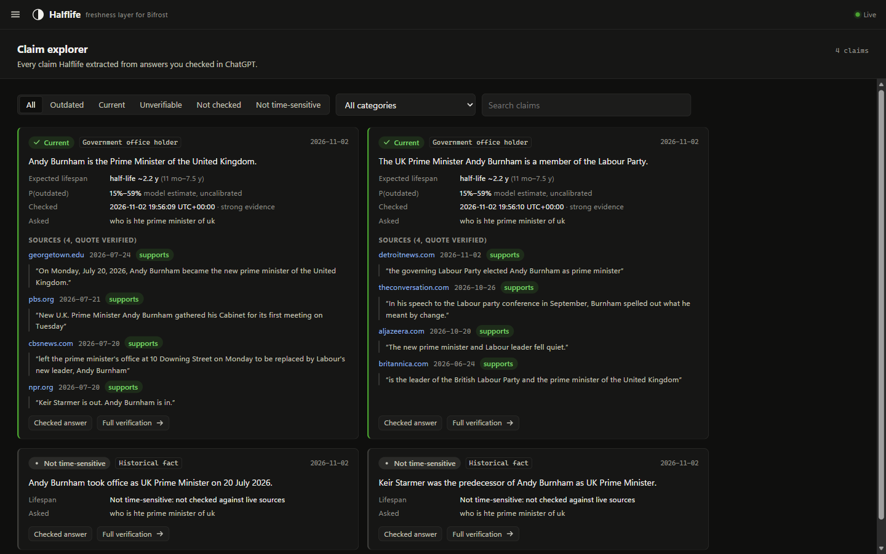
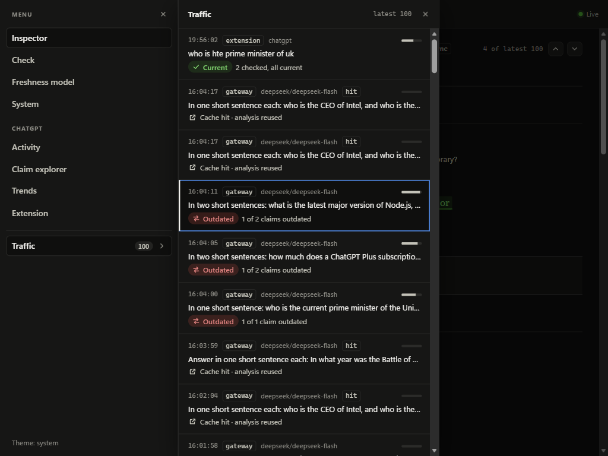
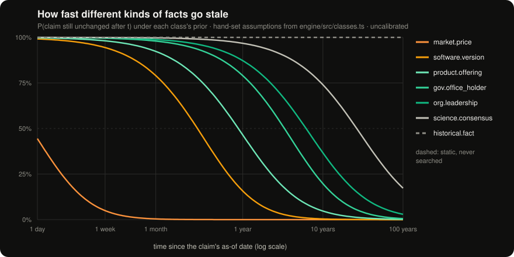
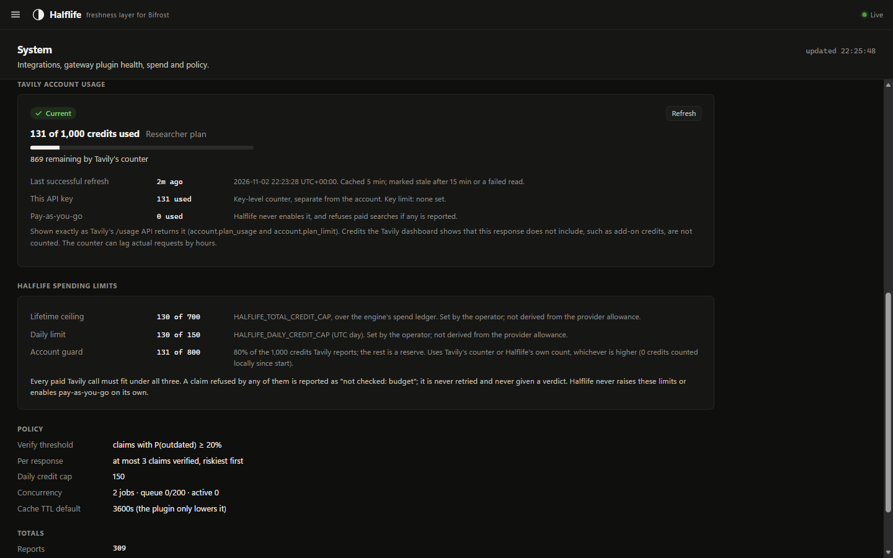

<p align="center">
  
</p>

<h3 align="center">Claim-level freshness detection and live verification for AI-generated answers</h3>

<p align="center">
  <a href="https://youtu.be/xGCQDT1-bp4"><b>▶ Demo video</b></a> ·
  <a href="HALFLIFE_Project_Presentation.pptx"><b>Presentation (PPTX)</b></a> ·
  <a href="#architecture">Architecture</a> ·
  <a href="#how-it-works">How it works</a> ·
  <a href="#installation-and-setup">Setup</a> ·
  <a href="#dashboard-console">Dashboard</a> ·
  <a href="#browser-extension-chatgpt">Extension</a> ·
  <a href="#limitations">Limitations</a> ·
  <a href="docs/ARCHITECTURE.md">Docs</a>
</p>

<p align="center">
  
  
  
  
  
</p>

---

**AI-generated answers can become outdated because different facts expire at different rates.** "The Berlin Wall fell in 1989" will never change; "the latest Python is 3.12" was out of date within months. **HALFLIFE detects freshness risk at the claim level and checks potentially outdated claims against current evidence.**

It splits an answer into individual claims, estimates how likely each one is to have gone stale from what *kind* of fact it is and how old it is, searches the web with [Tavily](https://tavily.com) only for the risky ones, and reports a verdict per claim with quotes that are checked against the source in code. It runs as a plugin and companion engine for the [Bifrost](https://github.com/maximhq/bifrost) AI gateway, and as an opt-in ChatGPT browser extension that sends one chosen answer to your own local engine.

HALFLIFE is **not a general fact-checker**. It answers one question, *could this claim have gone out of date?*, and abstains on claims that cannot (a wrong historical date passes through unchecked).


<sub>Real report from a local development run: DeepSeek answer through Bifrost, Tavily evidence. Times in UTC. Screenshot provenance: <a href="docs/assets/screenshots/README.md">docs/assets/screenshots/README.md</a>.</sub>

> [!NOTE]
> **Status:** hackathon prototype built for the Geek Room Global AI Hackathon 2026 (Bifrost Problem 04, Tavily Problem 06). It runs end to end against real services and has automated tests, but it is single-node, uses SQLite, is not load-tested, and its outdated-probability score is **not calibrated**.

## Demo video and presentation

[](https://youtu.be/xGCQDT1-bp4)

| | |
|---|---|
| ▶ **Demo video** | [youtu.be/xGCQDT1-bp4](https://youtu.be/xGCQDT1-bp4) |
| **Project presentation** (18 slides, editable, with speaker notes) | [`HALFLIFE_Project_Presentation.pptx`](HALFLIFE_Project_Presentation.pptx) — open it, or use GitHub's *Download raw file* button |
| **Video slides** (the deck used in the demo video) | [`HALFLIFE_Video_Slides.pptx`](HALFLIFE_Video_Slides.pptx) |
| Slide-by-slide notes | [`PRESENTATION_NOTES.md`](PRESENTATION_NOTES.md) · deck sources and slide previews in [`presentation_assets/`](presentation_assets/) |

<details>
<summary><b>Contents</b></summary>

- [Demo video and presentation](#demo-video-and-presentation)
- [The problem](#the-problem)
- [The solution](#the-solution)
- [Architecture](#architecture)
- [How it works](#how-it-works)
- [Browser extension (ChatGPT)](#browser-extension-chatgpt)
- [Dashboard (console)](#dashboard-console)
- [Freshness model](#freshness-model)
- [Bifrost integration (Problem 04)](#bifrost-integration--problem-04)
- [Tavily integration (Problem 06)](#tavily-integration--problem-06)
- [Technology stack](#technology-stack)
- [Security and privacy](#security-and-privacy)
- [Installation and setup](#installation-and-setup)
- [Testing and validation](#testing-and-validation)
- [Evaluation](#evaluation)
- [Limitations](#limitations)
- [Roadmap](#roadmap)
- [Project structure](#project-structure)
- [Hackathon context](#hackathon-context)
- [License and credits](#license-and-credits)

</details>

---

## The problem

Language models answer from training data that is months or years old, and they state every sentence with the same confidence. A single answer routinely mixes facts that will never change with facts that may have changed last week:

> *"Python was created by Guido van Rossum and first released in 1991. The latest version is Python 3.12, and Microsoft's CEO is Satya Nadella."*

The first sentence is permanent. The second contains two time-sensitive claims with very different shelf lives: software versions turn over in months, company leadership over years. Judging this answer as one unit fails in both directions:

- **Check the whole answer:** you pay to search for facts that cannot change, and a single stale clause is diluted by the correct ones around it.
- **Trust the whole answer:** the stale version number reaches the user, and a gateway cache may keep serving it for hours.

How quickly a claim goes stale depends mostly on its **class** and its **age** (the time since the date it describes, or the model's training cutoff when no date is stated):

| Kind of fact | Example | Typical time between changes (HALFLIFE's prior) |
|---|---|---|
| Market prices | "Bitcoin trades at $60k" | about a day |
| Software versions | "The latest Python is 3.12" | about 4 months |
| Policy rates | "The Fed funds rate is 5.25–5.5%" | about 6 months |
| Products and plans | "ChatGPT Plus costs $20/month" | about a year |
| Government office holders | "Rishi Sunak is the UK prime minister" | about 4 years |
| Company leadership | "Satya Nadella is CEO of Microsoft" | about 7 years |
| Scientific consensus | "Pluto is classified as a dwarf planet" | decades |
| Historical facts, definitions | "The Berlin Wall fell in 1989" | never (not checked) |

<sub>Examples are the ones the extraction model is given in <code>engine/src/classes.ts</code>. The lifetimes are hand-set prior assumptions with written rationale, not measurements.</sub>

## The solution

HALFLIFE handles each claim separately:

1. **Capture** an AI answer: from traffic passing through the Bifrost gateway, from text submitted to the API or console, or from a ChatGPT answer the user selects in the extension.
2. **Extract** individual factual claims. Each claim must be an exact substring of the answer.
3. **Classify** each claim into one of 18 classes (office holder, software version, price…), each with its own change rate.
4. **Estimate freshness risk:** the probability the claim has changed since its as-of date, as a range.
5. **Select** claims above a risk threshold (default 20%, at most 3 per answer, riskiest first). Static claims are never searched.
6. **Retrieve** current evidence with Tavily, through Bifrost's relay, inside layered spending limits.
7. **Compare:** a judge model returns a verdict with quotes; every quote is checked against the fetched source text in code.
8. **Report** a claim-level assessment with verified sources, and, for gateway traffic, adjust Bifrost's response cache.

### Three measures, never blended

| Measure | Question it answers | Form |
|---|---|---|
| **Freshness risk** — P(outdated now) | Given its class and age, how likely is it that this claim has changed? | a probability range, labelled *estimated · uncalibrated* |
| **Verification verdict** | What does current evidence say? | `current` · `superseded` · `contradicted` · `unverifiable`, or `not_checked` with a reason |
| **Evidence confidence** | How strong is the evidence behind that verdict? | `strong` · `moderate` · `weak` · `none`, from explicit rules — never a percentage |

None of these is **factual correctness**. A high freshness risk means "worth checking", not "wrong". A `current` verdict means the retrieved evidence supports the claim today, not that the claim is guaranteed true. The language model never produces a number: it returns spans, a class from a closed list, dates, a verdict enum and quotes, and code validates all of them.

## Architecture



**Model inference and evidence retrieval are separate paths.** DeepSeek is only ever reached as an LLM provider behind Bifrost (for the application's own answer, and for HALFLIFE's extraction and verdict calls). Tavily is only reached through Bifrost's `/relay/tavily` route, which holds the Tavily key. Neither the engine nor the browser extension holds a provider key; they live only in the gateway container's environment.

| Component | Where | Role |
|---|---|---|
| **ChatGPT extension** — content script | `extension/src/content.js`, `src/adapters/chatgpt.js` | Adds **Check freshness** under completed ChatGPT answers, reads the selected answer and the user message before it, shows the compact result. Makes no network calls. |
| **ChatGPT extension** — service worker | `extension/src/background.js` | Validates messages from its own content scripts and popup, holds the pairing token (IndexedDB), and is the only part that calls the engine, at a loopback address only. |
| **Bifrost gateway** | `deploy/gateway.Dockerfile` | Bifrost `transports/v2.4.0`, compiled from source at pinned commit `e869c3f` so it can load Go plugins. Routes LLM calls to providers, hosts the relays and the response cache. |
| **HALFLIFE plugin** | `plugin/` (Go) | Runs inside Bifrost: microsecond-scale lexical triage, cache TTL caps or `no-store`, prompt and answer capture, bounded async hand-off to the engine, response headers, synchronous `verify` mode. Fails open. |
| **DeepSeek** | via Bifrost's native `deepseek` provider | Reference judge model (`deepseek/deepseek-flash`, thinking disabled, temperature 0) for claim extraction, classification and verdicts. |
| **Tavily relay** | Bifrost relay `/relay/tavily/*` | Forwards the engine's `search`, `extract` and free `GET /usage` calls to Tavily, priced per credit against the engine's virtual key. |
| **HALFLIFE engine** | `engine/src/` (Node 24, zero npm dependencies) | Claim extraction and classification, freshness model, verification ladder, evidence rules, learning, cache actions, credit guard, HTTP API, SSE. |
| **Storage** | `node:sqlite` in the `engine-data` volume | Reports, claims, evidence, learning observations, cache schedules, spend ledger, extension pairings (token hashes only). 14-day retention by default. |
| **Console** | `engine/console/` | The dashboard, served by the engine on port 8090. Vanilla HTML/CSS/ES modules, live via server-sent events. |

Every design decision, with the alternatives considered, is recorded in [research/ARCHITECTURE_DECISIONS.md](research/ARCHITECTURE_DECISIONS.md) (AD-01 to AD-38). A longer component walkthrough is in [docs/ARCHITECTURE.md](docs/ARCHITECTURE.md).

## How it works

The sequence below follows a check started from the ChatGPT extension. Gateway traffic enters the same pipeline from the plugin instead (see [Bifrost integration](#bifrost-integration--problem-04)).



<details>
<summary><b>Each stage in plain terms</b></summary>

| Stage | What happens | Code |
|---|---|---|
| Selecting an answer | Nothing is read until the user clicks. The button only appears on completed answers, never on one still streaming. | `extension/src/content.js` |
| Extracting prompt and answer | The ChatGPT adapter recognises three DOM layouts and reads that answer plus the user turn directly before it. If no layout matches, no button appears. | `extension/src/adapters/chatgpt.js` |
| Sending the check | The service worker sends it to the paired engine; the engine enforces a strict schema (answer ≤ 60,000 chars, question ≤ 4,000), per-minute and per-day limits, and returns the saved result for a repeat of the same message and text. | `extension/src/background.js`, `engine/src/extension.ts` |
| Claim extraction | The judge returns claim spans, which must be exact substrings of the answer, plus a class from a closed list of 18. Invalid items are dropped. Without an LLM key a labelled rule-based extractor is used. | `engine/src/extract.ts`, `prompts.ts` |
| Freshness evaluation | The as-of date is an interval (stated date → earlier verification → the model's cited cutoff → an assumed 6–36 months). The class model turns that into a P(outdated) range. | `engine/src/asof.ts`, `freshness.ts` |
| Evidence retrieval | Reuse a stored verdict inside its reuse window (T0), else Tavily search (T1), else Tavily extract on the top two URLs (T2). Each paid call is reserved with the credit guard first. | `engine/src/verify.ts`, `tavily.ts`, `credits.ts` |
| Evidence comparison | The judge returns a verdict with quotes. Quotes not found in the source are dropped; a verdict left with none becomes `unverifiable`. A "superseded" change dated in the future is discarded. A replacement value is shown only if a verified quote contains it. | `engine/src/verify.ts` |
| Final assessment | Evidence confidence comes from explicit rules: number of verified quotes, independent sites, recency after the as-of date, conflicting sources. | `engine/src/evidence.ts` |
| Viewing the result | A compact card under the ChatGPT answer; the full report in the console (ChatGPT → Activity, then Inspector). | `engine/console/views/` |

</details>

## Browser extension (ChatGPT)

An opt-in Manifest V3 extension ([`extension/`](extension/README.md)) for `chatgpt.com` and `chat.openai.com`, tested in Edge and Chrome. It has no dependencies and no build step, and is not published to any extension store.

- **Integration:** content scripts run on ChatGPT pages. All ChatGPT-specific DOM knowledge lives in one adapter, which reads three page layouts and assumes none of them is permanent. The UI lives in a closed shadow root and follows ChatGPT's light or dark theme.
- **Starting a check:** click **Check freshness** under a completed answer. Only that answer and the user message before it are sent, with ChatGPT's message id, the model slug if the page shows one, and a SHA-256 of the conversation id.
- **Pairing:** in the console, ChatGPT → Extension → **Create pairing code** (one-time, valid 10 minutes). Enter the console address (`http://127.0.0.1:8090`) and the code in the extension popup. The service worker exchanges it, from its `chrome-extension://` origin, for a random 256-bit bearer token.
- **Results:** a card under the answer shows an overall assessment ("Outdated information found", "Possibly outdated (weak evidence)", "Checked claims are current", "No time-sensitive claims"…), counts of claims examined, potentially outdated, superseded or contradicted, and checked live, plus **Open in Halflife** and **Re-check**. The popup shows connection status, today's and total checks, pause/resume, recent checks and a diagnostics line.
- **Permissions:** `storage`, plus host access to `https://chatgpt.com/*`, `https://chat.openai.com/*`, `http://127.0.0.1/*` and `http://localhost/*`. No `tabs`, `scripting`, `cookies` or `webRequest`. The extension pages' CSP only allows connections to loopback addresses.

Extension checks run through the same pipeline as gateway traffic with `learn: false`, so they never update the freshness model.

| | |
|---|---|
|  |  |
| **TEST FIXTURE** — result card under an answer | **TEST FIXTURE** — the popup after that check |

<sub>Both images show the real unpacked extension, but on a local test page with ChatGPT's message markup (not chatgpt.com) and against HALFLIFE's scripted test engine (<code>engine/test/fixture-server.ts</code>: 0 tokens, 0 credits). They are not real results. A screenshot on real chatgpt.com was not taken because it would show a personal signed-in account; the maintainer tested the extension manually on real chatgpt.com on 2026-11-03. The real check from that test appears in the console screenshots below.</sub>

## Dashboard (console)

The engine serves the console at <http://localhost:8090>. It has a slim top bar and one collapsible navigation sidebar (docked at ≥ 1100 px and remembered; a modal overlay below that), updates live over server-sent events, and follows the system light/dark theme. Screenshots are dark theme, captured from the running local stack in a real Edge window with the time zone set to UTC.

| Page | What it does |
|---|---|
| **Inspector** | One report: the answer with each claim highlighted in place; a claim panel with verdict, timeline (as-of date → verification), the three measures, the evidence rules applied and quote-verified sources; gateway headers, cache action and spend. |
| **Check** | Send a prompt *through the Bifrost gateway* exactly as an application would (the plugin handles it), or paste any text for direct analysis. Stages stream live. |
| **Freshness model** | The 18 classes with their half-life and 90% interval, the prior's rationale, and prior vs learned posterior. |
| **System** | Gateway reachability, plugin heartbeat and counters, judge model, Tavily and cache status, daily spend, Tavily account usage *as Tavily reports it*, and HALFLIFE's own spending limits. |
| **ChatGPT → Activity** | Answers checked from the extension, newest first, with a compact detail and a link to the Inspector. |
| **ChatGPT → Claim explorer** | Individual claims across those answers with verdict, freshness estimate, expected lifespan, quote-verified sources and (only when a verified quote states it) the replacement value. |
| **ChatGPT → Trends** | Per-day volume, outdated claims over time, which classes go out of date most, and verification outcomes. Real data only; an empty range says so. |
| **ChatGPT → Extension** | Paired browsers and revocation, pairing codes, the kill switch, estimate-only mode, rate limits, retention, the privacy statement and deletion. |
| **Traffic** | A live list of the latest 100 reports, opened from the sidebar or with `T` on any page: a panel beside the sidebar on wide screens, a full-screen sheet below 700 px. |

<table>
<tr>
<td width="50%"><br><b>Inspector — claim panel.</b> Verdict, replacement value, timeline, the three measures and quote-verified sources.</td>
<td width="50%"><br><b>Traffic.</b> The latest 100 reports, beside the sidebar.</td>
</tr>
<tr>
<td><br><b>Freshness model.</b> Half-life per class, prior vs posterior.</td>
<td><br><b>System — integrations.</b> Health of every dependency and today's spend.</td>
</tr>
<tr>
<td><br><b>ChatGPT → Activity.</b> One real chatgpt.com answer: four claims, two checked live.</td>
<td><br><b>ChatGPT → Claim explorer.</b> Claims of that check with sources.</td>
</tr>
<tr>
<td><br><b>ChatGPT → Trends.</b> Real aggregates; only one check, so the charts are sparse.</td>
<td><br><b>ChatGPT → Extension.</b> Pairing, limits and privacy controls.</td>
</tr>
</table>

<details>
<summary><b>Responsive layouts</b> (sidebar, tablet, phone)</summary>

| Sidebar docked (1440 px) | Tablet (1024 px) | Phone (390 px) |
|---|---|---|
|  |  |  |

</details>

The console has **no authentication unless `HALFLIFE_CONSOLE_TOKEN` is set**; its port is bound to `127.0.0.1` and should not be exposed.

## Freshness model

<p align="center">
  
</p>

<sub>Generated from the priors in <code>engine/src/classes.ts</code> (P(unchanged after t) = (β/(β+t))<sup>α</sup>). These are prior assumptions before any learning, not measurements.</sub>

**Implemented** (`engine/src/classes.ts`, `freshness.ts`, `learn.ts`):

- **Change rate per class.** Changes to a claim of class *c* are modelled as a Poisson process with uncertain rate λ ~ Gamma(α, β). Each of the 18 classes has a hand-set "typical lifetime" and shape with a written rationale; one (org leadership) draws on Wikidata CEO tenure data from the feasibility sprint. The console shows it as a half-life (ln 2 / λ) with a 90% interval.
- **P(outdated now).** For a claim of age Δt since its as-of date: `1 − (β/(β+Δt))^α`, evaluated on a 720-point λ grid (tested against the analytic form for all 18 classes). The as-of date is an interval, so the result is a range.
- **Time sensitivity drives verification.** Claims at or above θ = 0.2 are verified, at most 3 per answer, riskiest first. `historical.fact` and `static.definition` are never searched; past-tense statements about an explicitly dated past state count as historical.
- **Reuse window.** After a verification, the claim is not searched again until P(outdated since verification) reaches θ, so repeated claims cost 0 credits.
- **Learning.** Verdicts with strong or moderate evidence become interval-censored observations that update the class posterior on the grid. Requests with `learn: false` (evaluation traffic and all extension checks) never do.

**Why this is not accuracy.** The model says how likely a claim is to have *changed*, from its class and age alone. It knows nothing about whether the claim was right in the first place. Evidence confidence is computed separately from the retrieved sources, and **the verdict that drives cache actions comes from evidence, not from this probability**.

**Not implemented or not established:** calibration. The priors are hand-set, few verified outcomes have updated them (12 gateway-derived observations after evaluation data was removed), and the evaluation did not measure calibration. The score is labelled *estimated · uncalibrated* wherever it appears. DeepSeek's knowledge cutoff is unpublished, so the assumed as-of range for its answers is wide.

## Bifrost integration — Problem 04

**Why Bifrost.** A freshness layer belongs where answers already flow: at the gateway. Bifrost gives HALFLIFE one place to see prompts and answers for every provider, a response cache to correct, relays to hold third-party keys, and virtual-key budgets for governance, all through supported extension points, with no changes to Bifrost's source.

**What the plugin contributes** (`plugin/`, Go standard library plus `bifrost/core/schemas` only, registered `post_builtin` so it can set the semantic cache's TTL key):

| Hook | Work |
|---|---|
| `HTTPTransportPreHook` | Create the report ID, read `x-halflife-mode`, skip the engine's own traffic (valid internal token only), capture the prompt. |
| `PreLLMHook` | Streams: prompt-level triage → TTL cap or `no-store`. |
| `PostLLMHook` | Non-streams: answer-level triage → TTL cap or `no-store`; capture the answer; in `verify` mode, call the engine synchronously and annotate a stale reply. |
| `HTTPTransportPostHook` | Read cache id and hit status; enqueue the ingest job. |
| `HTTPTransportStreamChunkHook` | Accumulate streamed text; enqueue at the final chunk. |
| `HTTPTransportResponseHeadersHook` | Add `x-halflife-report`, `-mode`, `-ttl`, `-triage`, `-cache`, `-status`. |

Triage uses lexical cue groups from `shared/temporal-cues.json` ("latest", prices, versions, office titles…), each with a TTL cap; price answers become `no-store`. Measured cost was about 42 µs for all hooks on one request. Every hook recovers panics and passes the response through unchanged; the hand-off queue is bounded and drops (counted) rather than blocks; if the engine is down, inference is unaffected (tested).

**How inference is routed.** All LLM calls, including HALFLIFE's own extraction and verdict calls, go through Bifrost's `/v1/chat/completions` to the configured provider. The engine's calls carry a secret internal token so the plugin skips them and they never loop back into the pipeline. Bifrost rewrites the JSON-schema request into DeepSeek's `json_object` mode.

**How it fits together.**
- `/relay/tavily/*` holds the Tavily key and prices each call per credit against the engine's virtual key (Bifrost returns 402 when the daily dollar budget runs out).
- `/relay/halflife/*` exposes the engine's read and check API behind a virtual key with a route allow-list; extension routes return 403 through it.
- The engine calls Bifrost's cache admin API to delete an entry once a claim in it is confirmed `superseded` or `contradicted` with at least moderate evidence, or schedules deletion when the claims' reuse window ends. Cache hits are linked to the original report at no cost.
- Request header `x-halflife-mode: verify` makes the reply wait for verification and carry a freshness note when a claim is outdated (never cached); `off` opts a request out.

The official Bifrost image is statically linked and cannot load Go plugins, so `deploy/gateway.Dockerfile` builds Bifrost from source at the pinned tag and verifies the commit. Bifrost's web UI is replaced by a stub page in this image. This project has not been submitted upstream and does **not** claim acceptance or endorsement by the Bifrost maintainers.

## Tavily integration — Problem 06

**Why live retrieval.** A model cannot tell from its own weights whether "the latest Node.js is 22" is still true. Only current evidence can, so HALFLIFE checks risky claims against the web at the moment of the check.

**How evidence is retrieved** (`engine/src/verify.ts`, `tavily.ts`), cheapest first:

| Tier | Action | Cost |
|---|---|---|
| T0 | Reuse a stored verdict for the same normalised claim and class inside its reuse window | 0 credits |
| T1 | Tavily `search`: basic depth, published dates, topic chosen by class (general / news / finance), 5 results | 1 credit |
| T2 | Tavily `extract` on the top 2 URLs, only if T1 yielded no verifiable quote | about 1 credit |

Results are passed to the judge as delimited, untrusted data. Only quotes found verbatim in the retrieved text survive, and evidence confidence is graded by rules over those verified quotes (count, independent sites, recency after the as-of date, conflicts). The engine never holds the Tavily key; every call goes through the Bifrost relay.

**Usage limits and spending safeguards** (`engine/src/credits.ts`). Before every paid call, credits are reserved (serially, so concurrent claims cannot overshoot) against independent limits. Any refusal reports the claim as `not_checked` (reason `budget`): never given a verdict, never retried.

| Safeguard | Source | Behaviour |
|---|---|---|
| **Provider-reported allowance** | Tavily `GET /usage` → `account.plan_usage` / `account.plan_limit`, read through the relay | Free call; read at start, cached 5 minutes (Tavily limits it to 10 reads per 10 minutes), manual refresh at most every 120 s. Displayed exactly as reported. Never assumed or hardcoded. |
| **HALFLIFE lifetime ceiling** | `HALFLIFE_TOTAL_CREDIT_CAP` (default 700), summed over the engine's own spend ledger | Configuration only; a larger provider allowance never raises it. |
| **HALFLIFE daily limit** | `HALFLIFE_DAILY_CREDIT_CAP` (default 150) | Configuration only. |
| **Account usage guard** | `floor(plan_limit × HALFLIFE_TAVILY_CEILING_FRACTION)` (default 0.8, clamped to 0.95 in code) | Because Tavily's counter was observed to lag by minutes to hours, usage is taken as the maximum of Tavily's counter, the first reading plus every credit reserved locally since, and the engine's lifetime spend. A finite API-key limit is guarded the same way. Fails **closed** if usage or a finite allowance cannot be read. |
| **Pay-as-you-go protection** | `account.paygo_usage` from `/usage` | If Tavily reports any pay-as-you-go usage, paid calls are refused. HALFLIFE cannot change account billing settings; it stops spending. |
| **Bifrost budget** | `HALFLIFE_ENGINE_BUDGET_USD` (default $2/day) on the engine's virtual key | Bifrost returns 402 when exhausted. |
| **Per answer** | θ = 0.2, max 3 claims | Static claims never searched; reuse is free. |

> [!IMPORTANT]
> Tavily's `/usage` API does **not** report add-on credits that appear only on Tavily's dashboard. HALFLIFE cannot see or account for them: the guard is computed from `account.plan_limit` alone, so it may stop earlier than the dashboard total suggests. This is deliberate; HALFLIFE never raises its own limits.

The System page shows the provider's figures ("Tavily account usage") and HALFLIFE's limits ("Halflife spending limits") separately:



## Technology stack

| Area | Technology |
|---|---|
| Backend and engine | Node.js 24 with native TypeScript type stripping (`.ts` run directly), `node:http`, `node:sqlite`, `node:crypto`; **no npm dependencies**, no build step |
| Bifrost plugin | Go, CGO, `-buildmode=plugin`, compiled inside Bifrost's `transports/v2.4.0` module; standard library + `bifrost/core/schemas` |
| Gateway | Bifrost `transports/v2.4.0` (commit `e869c3f`) built from source in `golang:1.27.3-bookworm`; `semantic_cache` plugin (exact match) |
| AI model integration | DeepSeek `deepseek-flash` via Bifrost's native `deepseek` provider. OpenAI, Anthropic, Gemini, Groq, OpenRouter, Mistral and Ollama are wired into the config renderer but untested live. |
| Search and retrieval | Tavily Search, Extract and Usage APIs via a Bifrost relay |
| Browser extension | Manifest V3, plain JavaScript, closed shadow DOM, IndexedDB in the service worker; Chromium (Edge, Chrome) |
| Dashboard | Vanilla HTML, CSS and ES modules, server-sent events; no framework |
| Testing | `node:test`; Go `testing` with `-race`; headless Edge/Chrome over the Chrome DevTools Protocol for console and extension tests; Docker-based integration suite with labelled test fixtures |
| Deployment | Docker Compose v2: one-shot config renderer, gateway, engine; named volumes |

## Security and privacy

- **No provider keys outside the gateway.** DeepSeek and Tavily keys live only in the gateway container's environment; the rendered Bifrost config references them as `env.NAME`. The engine and the extension never see them.
- **Separate authentication per caller.** Plugin → engine uses an ingest token on the internal Docker network; relay → engine uses a bearer token that Bifrost injects; callers of the relay need a virtual key; the engine's own gateway calls use a separate internal token; the console uses a header plus an optional `HALFLIFE_CONSOLE_TOKEN`.
- **Extension pairing.** A one-time code (valid 10 minutes; repeated failed attempts withdraw all outstanding codes) is exchanged for a random 256-bit token. The engine stores only its **SHA-256**, bound to the extension's `chrome-extension://` origin; a request with a different `Origin` is refused even with a valid token. Tokens can be **revoked** from the popup or the console.
- **Ownership and scope.** An extension token can create checks, read **only its own** checks and read a minimal status. It cannot read gateway traffic, the event stream, settings or other connections' checks. Extension routes answer only for a loopback `Host` (DNS-rebinding defence) and return 403 through the relay.
- **Untrusted input.** Answers and web evidence are delimited in prompts; model outputs are schema-validated; spans and quotes are checked against their sources.
- **Local data.** Prompts, answers, claims and evidence excerpts are stored in SQLite (14-day retention by default; extension checks 30 days, deletable individually or all at once). Bifrost's log store also records requests. Text sent through HALFLIFE goes to the configured LLM provider, and search queries to Tavily.
- **No telemetry.** No code path sends data anywhere except the configured LLM provider and Tavily (through Bifrost), and the extension sends only to a loopback engine after a click.
- **Network exposure.** Ports bind to `127.0.0.1`. The console is unauthenticated unless `HALFLIFE_CONSOLE_TOKEN` is set.

These are the protections implemented for a single-machine prototype, not a security audit. Threat boundaries: [docs/SECURITY.md](docs/SECURITY.md).

## Installation and setup

### Prerequisites

| Requirement | Notes |
|---|---|
| Docker with **Compose v2** | Docker Desktop on Windows (WSL 2) or macOS; Docker Engine + `docker compose` on Linux. Only exercised on x86-64 Windows + WSL 2. |
| **Node.js 24+** | Runs `deploy/setup.mjs`, tests and scripts. Older versions lack native TypeScript stripping and `node:sqlite`. |
| Git, ~5 GB free disk, 8 GB+ RAM | The first build clones and compiles Bifrost. Go is **not** needed on the host. |
| Edge or Chrome | For the extension and the browser test suites. |

| Key | Required? | Without it |
|---|---|---|
| `DEEPSEEK_API_KEY` ([platform.deepseek.com](https://platform.deepseek.com/api_keys), positive balance) | for live extraction and verdicts | a labelled rule-based extractor is used and no verdicts are made |
| `TAVILY_API_KEY` ([app.tavily.com](https://app.tavily.com)) | for live verification | risky claims are reported as `not checked` |

### 1. Download and configure

Get the code with Git (recommended):

```bash
git clone https://github.com/fazeprism25/halflife.git
cd halflife
```

or without Git: on [github.com/fazeprism25/halflife](https://github.com/fazeprism25/halflife) choose **Code → Download ZIP**, extract it, and open a terminal in the extracted `halflife-main` folder.

Then generate the local configuration:

```bash
node deploy/setup.mjs        # creates deploy/.env with generated local secrets; prints variable names only
```

Edit `deploy/.env` and set your provider keys (placeholders only shown here):

```dotenv
TAVILY_API_KEY=<your Tavily key>
DEEPSEEK_API_KEY=<your DeepSeek key>
```

`setup.mjs` generates the ingest, internal and relay tokens, the Bifrost admin token and two virtual keys; they need no editing. `deploy/.env` is gitignored. Every variable is documented in [`deploy/.env.example`](deploy/.env.example).

> [!WARNING]
> Compose reads provider keys from your **shell environment first** and `deploy/.env` second. A key exported in your shell is used even if `deploy/.env` is empty or different.

### 2. Start Bifrost, the plugin and the engine

```bash
docker compose -f deploy/docker-compose.yml up --build -d
docker ps                    # wait until halflife-gateway-1 and halflife-engine-1 are "healthy"
```

The one-shot `config` service renders Bifrost's `config.json` (DeepSeek provider, Tavily and HALFLIFE relays, cache, virtual keys and budgets) from the keys present, so no separate Bifrost or Tavily setup is needed. The first build takes several minutes; later starts use the cache.

| Service | Address |
|---|---|
| Bifrost gateway (OpenAI-compatible) | `http://localhost:8080/v1/chat/completions` |
| Console (dashboard) | <http://localhost:8090> |
| HALFLIFE API through Bifrost | `http://localhost:8080/relay/halflife/v1/...` with header `x-bf-vk: <HALFLIFE_DEMO_VK>` |

There is no separate dashboard start step: the engine serves the console. Verify with `curl http://localhost:8090/v1/health`, then open **System**.

### 3. Send traffic

```bash
# load the demo virtual key without printing it (bash)
export HALFLIFE_DEMO_VK=$(grep '^HALFLIFE_DEMO_VK=' deploy/.env | cut -d= -f2-)

# through the gateway, as an application would
curl -i http://localhost:8080/v1/chat/completions \
  -H "content-type: application/json" -H "x-bf-vk: $HALFLIFE_DEMO_VK" \
  -d '{"model":"deepseek/deepseek-flash","thinking":{"type":"disabled"},"messages":[{"role":"user","content":"In one short sentence: what is the latest major version of Node.js?"}]}'

# or check any text directly
curl http://localhost:8080/relay/halflife/v1/check -H "x-bf-vk: $HALFLIFE_DEMO_VK" \
  -H "content-type: application/json" \
  -d '{"text":"As of 2023, Jack Dorsey is the CEO of Twitter.","question":"Who is the CEO of Twitter?","wait":true}'
```

The gateway response carries `x-halflife-report`; open that report in the console. You can do the same from the console's **Check** page.

> DeepSeek enables "thinking" by default. Send `"thinking":{"type":"disabled"}` with small `max_tokens`, or the reply can be empty (reported as `skipped; no-text`).

<details>
<summary><b>API reference</b></summary>

Through the relay (`/relay/halflife` prefix, header `x-bf-vk`):

| Method | Path | Purpose |
|---|---|---|
| `GET` | `/v1/health` | liveness |
| `GET` | `/v1/status` | integrations, plugin heartbeat, spend and guard status, policy |
| `GET` | `/v1/classes` | the 18 claim classes with priors and learned posteriors |
| `GET` | `/v1/reports?limit=&before=` | recent reports |
| `GET` | `/v1/reports/{id}` | one claim-level report |
| `POST` | `/v1/check` | analyse a text |

`/v1/check` body: `text` (required), `question`, `model` (the model that wrote the text, for its knowledge cutoff), `as_of` (`YYYY-MM`), `wait`, `verify: false` (assess only: no search, 0 credits), `learn: false` (do not update the class model).

Console-only (port 8090): `/v1/events` (SSE), `/v1/playground`, `/v1/usage/refresh`, extension settings. Plugin-only (internal network): `/v1/ingest`, `/v1/plugin/heartbeat`. Extension (loopback, paired token): `/v1/extension/status`, `/v1/extension/checks`, `/v1/extension/token`.

Gateway response headers: `x-halflife-report` (report id), `-mode` (`async`/`verify`/`off`), `-triage` (matched cue groups), `-ttl` (applied TTL, `default` or `no-store`), `-cache` (`hit`), `-status` (verify mode summary).

</details>

<details>
<summary><b>Optional configuration</b></summary>

| Variable (default) | Purpose |
|---|---|
| `HALFLIFE_LLM_MODEL` (`deepseek/deepseek-flash` with DeepSeek) | judge model |
| `HALFLIFE_LLM_FALLBACKS`, `HALFLIFE_LLM_EXTRA_BODY` | Bifrost fallbacks; provider-specific request fields |
| `HALFLIFE_PLAYGROUND_MODELS` | models offered on the Check page |
| `HALFLIFE_DEFAULT_MODE` (`async`) | plugin mode without an `x-halflife-mode` header |
| `HALFLIFE_CACHE_TTL_SECONDS` (`3600`) | Bifrost cache TTL; the plugin only lowers it |
| `HALFLIFE_DAILY_CREDIT_CAP` (`150`), `HALFLIFE_TOTAL_CREDIT_CAP` (`700`) | HALFLIFE's daily and lifetime Tavily credit limits |
| `HALFLIFE_TAVILY_CEILING_FRACTION` (`0.8`, max `0.95`), `HALFLIFE_TAVILY_ACCOUNT_GUARD` (`1`) | account guard share and on/off |
| `HALFLIFE_ENGINE_BUDGET_USD` (`2`), `HALFLIFE_DEMO_BUDGET_USD` (`1`) | Bifrost daily dollar budgets on the two virtual keys |
| `HALFLIFE_CONSOLE_TOKEN` (empty) | require a token for the console API |
| `HALFLIFE_OLLAMA_URL` | add a local Ollama provider (untested end to end) |

Engine tuning (`HALFLIFE_THETA`, `HALFLIFE_MAX_VERIFY_PER_RESPONSE`, `HALFLIFE_CONCURRENCY`, `HALFLIFE_RETENTION_DAYS`, timeouts) is read in `engine/src/config.ts`; add these to the `engine` service's `environment` in Compose to use them. After changing `deploy/.env`, run `docker compose -f deploy/docker-compose.yml up -d --force-recreate`.

</details>

### 4. Install and pair the browser extension

1. Open `chrome://extensions` or `edge://extensions`, enable **Developer mode**, choose **Load unpacked** and select the `extension/` folder.
2. In the console, open **ChatGPT → Extension** and click **Create pairing code**.
3. In the extension popup, enter `http://127.0.0.1:8090` and the code.
4. On chatgpt.com, click **Check freshness** under an answer.

The engine must run on the same machine. More detail: [extension/README.md](extension/README.md).

### 5. Run the tests

```bash
cd engine && npm test && cd ..                 # engine unit + HTTP tests (no Docker, no keys)
node engine/scripts/check-imports.mjs          # every engine module imports cleanly
node --test engine/test/console-ui.test.mjs    # console UI in headless Edge/Chrome (test fixtures)
node --test "extension/test/*.test.mjs"        # extension adapter + end-to-end (Edge/Chrome; openssl for e2e)
node deploy/test/integration.mjs               # real Bifrost + plugin + engine, scripted fixtures (Docker, port 8080)
docker build -f deploy/gateway.Dockerfile --target plugin-test --no-cache-filter plugin-test --progress=plain .
                                               # Go plugin tests with -race, plus benchmarks
```

Stop a running stack before the integration suite (it uses port 8080; `NO_BUILD=1` reuses built images). Live scripts against real services (`deploy/test/live-*.mjs`, `deploy/demo/run-demo.mjs`) spend credits and call `preflight()` / `reconcile()` from `deploy/test/spend-guard.mjs` first; see [docs/DEVELOPMENT.md](docs/DEVELOPMENT.md). Stop with `docker compose -f deploy/docker-compose.yml down` (`down -v` also deletes reports and the spend ledger). Troubleshooting: [docs/INSTALLATION.md](docs/INSTALLATION.md#8-troubleshooting).

## Testing and validation

| Suite | What it covers | Result | Source |
|---|---|---|---|
| Engine (`engine/test/*.test.ts`) | freshness model, credit guard, pipeline, HTTP API, extension service | **76/76** | re-run for this README, 2026-11-16 |
| Console UI (`engine/test/console-ui.test.mjs`) | sidebar, Traffic panel, keyboard, breakpoints, themes and the Tavily usage panel in headless Edge, test fixtures | **15/15** | re-run for this README, 2026-11-16 |
| Extension (`extension/test/*.test.mjs`) | 8 adapter tests on fixture DOMs + 6 end-to-end tests with the real unpacked extension | **14/14** | re-run for this README, 2026-11-16 |
| Integration (`deploy/test/integration.mjs`) | real Bifrost binary, plugin and engine with scripted LLM and Tavily fixtures | **13/13** | previously reported, 2026-11-03; not re-run here |
| Go plugin (`plugin/plugin_test.go`, `-race`) | hooks, triage, fail-open, queue, verify mode | **21/21** | previously reported, 2026-11-02; plugin unchanged since; not re-run here |

Limitations of the test evidence:
- Integration and browser tests use **labelled test fixtures** in place of DeepSeek, Tavily and chatgpt.com, so they need no credentials and spend nothing; they do not prove behaviour against the live services.
- Live DeepSeek and Tavily behaviour is covered by guarded live scripts and the evaluation below, not by the automated suites.
- Real chatgpt.com was tested manually once (2026-11-03), not itemised step by step.
- Browser tests run in Edge/Chrome only. The extension end-to-end suite once failed 9/14 on a pairing timeout before passing on unchanged code; the cause was not identified.
- There is no hosted CI.

## Evaluation

Measured on 2026-11-02 with real DeepSeek and Tavily calls on items drawn verbatim from two public [FreshQA](https://github.com/freshllms/freshqa) snapshots (2024-02-26 and 2026-04-21):

| Question | Result |
|---|---|
| **Detection:** is the claim time-sensitive? (100 items, assess-only, 0 credits) | precision 85.5%, recall 97.9%, F1 0.91 |
| **Verification:** 29 known-stale + 30 current answers, verdicts with ≥ moderate evidence | stale precision 95.8% (92.0% if the one unadjudicated item is wrong); recall 79.3% of all stale items |
| Replacement values on stale claims (26) | 10 match the dataset, 7 confirmed later changes, **2 wrong**, 1 unadjudicated, 6 omitted |
| Cost and latency | 1.04 Tavily credits per searched claim; ~4.5k DeepSeek tokens per checked claim; p50 3.9 s, p95 7.9 s |

The sets are small, one judge model was used, disputed items were adjudicated by the AI assistant that built the system (sources in `eval/freshqa-adjudications.json`), and calibration was **not** measured. FreshQA data is not redistributed; the scripts to rebuild and rerun are in `eval/`. Full methodology and failure analysis: [docs/EVALUATION.md](docs/EVALUATION.md).

## Limitations

- **Freshness, not fact-checking.** Static claims are never checked, so a stable but incorrect fact ("the Berlin Wall fell in 1991") passes through.
- **P(outdated) is not calibrated.** Hand-set priors updated by few observations; treat it as a ranking signal, not a probability you can rely on.
- **Evidence can be incomplete or wrong.** Tavily's `published_date` can be wrong for evergreen pages; sources can be out of date or unreliable; the judge can make date or count reasoning errors (future-dated changes are discarded in code, count errors are not).
- **Replacement values are weaker than verdicts** (2 of 26 wrong in the evaluation).
- **Tavily add-on credits are invisible.** The guard uses only the allowance `/usage` reports.
- **The extension depends on ChatGPT's page structure**, which can change without notice; it reads text only, Chromium only, unpacked install only, and needs the engine on the same machine.
- **Trends and the learned model are limited by history.** With few checks (the screenshots show one real extension check), charts are sparse and posteriors stay close to their priors.
- **Streams:** the cache TTL is decided from the prompt only, and streamed answers are verified asynchronously only.
- **Learning** can add near-duplicate observations from reworded prompts.
- **Operational:** single engine node with SQLite; not load-tested; Bifrost's UI is a stub in this image; governance usage counters reset on gateway restart; whether Bifrost's dollar budget meters DeepSeek spend is unverified.
- **Providers:** only DeepSeek (and the test fixtures) have been exercised end to end.

## Roadmap

Ideas that are **not implemented**:

- Measure calibration of P(outdated) on a larger labelled set, and fit class priors from data rather than hand-setting them.
- More evidence-quality signals (source reputation, publish-date sanity checks) and a guard against count-reasoning errors.
- Verify streamed answers before the final chunk, and decide stream TTLs from the answer.
- Evaluate additional judge models and providers already wired into the config renderer.
- Adapters for other chat interfaces, and a Firefox build of the extension.
- Multi-node storage, load testing, stronger console authentication and hosted CI.
- Propose the plugin to the Bifrost maintainers.

## Project structure

```text
halflife/
├── plugin/                    Go plugin for Bifrost: hooks, triage, per-request state, hand-off, tests
├── engine/
│   ├── src/                   pipeline, extraction, classes, freshness model, verification,
│   │                          evidence rules, credit guard, extension service, store, HTTP server
│   ├── console/               dashboard (vanilla ES modules), views/ for each page, traffic.js
│   ├── test/                  node:test suites, fakes, fixture server, console UI test
│   └── scripts/               import check
├── extension/                 MV3 extension: src/ (adapter, content script, service worker),
│                              popup/, icons/, test/ (adapter + CDP end-to-end)
├── shared/temporal-cues.json  lexical cue groups shared by plugin and engine
├── deploy/                    Dockerfiles, docker-compose.yml, config renderer, setup.mjs, .env.example
│   ├── test/                  integration suite, fixtures, live scripts, spend guard
│   └── demo/                  demo runner
├── eval/                      FreshQA builder/runner/scorer, labelled sets, adjudications, results
├── docs/                      architecture, installation, development, security, evaluation
│   └── assets/                screenshots/ (with provenance index), diagrams/ (README graphics)
├── experiments/feasibility/   feasibility-sprint probe plugin, configs and measured results (historical)
└── research/                  research and feasibility reports, architecture decisions, implementation
                               log, project state, demo script, submission draft
```

## Hackathon context

Built for the **Geek Room Global AI Hackathon 2026**, addressing two problem statements as described in the team's brief (the official wording and rubric were not confirmed from a public page; see [research/SUBMISSION.md](research/SUBMISSION.md)):

- **Bifrost Problem 04** — a production-quality feature using Bifrost's supported extension points. HALFLIFE uses a Go plugin (six hooks), two relays, the semantic cache's TTL key and the cache admin API, without modifying Bifrost.
- **Tavily Problem 06** — a stale-answer detector: find factual claims in LLM output that may be out of date, verify them against current information, and give claim-level freshness assessments. HALFLIFE does this with Tavily search and extract behind a credit guard.

No judging outcome or official recognition is claimed.

## License and credits

HALFLIFE is licensed under the [Apache License 2.0](LICENSE). Copyright 2026 The Halflife authors; see [NOTICE](NOTICE).

- [Bifrost](https://github.com/maximhq/bifrost) by maximhq (Apache-2.0, Copyright 2025 H3 Labs Inc.) — the gateway HALFLIFE extends. It is downloaded and compiled at build time, not included in this repository; images you build contain it.
- [Tavily](https://tavily.com) — web search and extraction. [DeepSeek](https://www.deepseek.com) — reference judge model.
- [FreshQA](https://github.com/freshllms/freshqa) (Vu et al., 2023, arXiv:2310.03214) — evaluation data, cited and not redistributed (no stated data licence).
- Third-party page titles and quotes in screenshots appear as the product shows them. Full attribution: [THIRD_PARTY_NOTICES.md](THIRD_PARTY_NOTICES.md).
- Built with an AI coding assistant (Claude Code); see the AI-use disclosure in [research/SUBMISSION.md](research/SUBMISSION.md).

Further reading: [Architecture](docs/ARCHITECTURE.md) · [Installation](docs/INSTALLATION.md) · [Development](docs/DEVELOPMENT.md) · [Security](docs/SECURITY.md) · [Evaluation](docs/EVALUATION.md) · [Contributing](CONTRIBUTING.md) · [Changelog](CHANGELOG.md)
